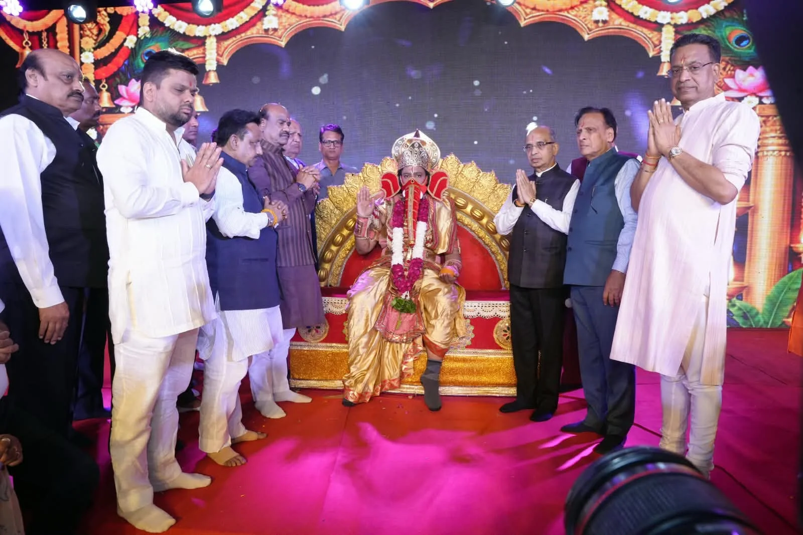

**नई दिल्ली।** दिल्ली के लाल किला मैदान में लव कुश रामलीला कमेटी की रामलीला का भव्य शुभारंभ लोकसभा अध्यक्ष ओम बिरला ने विधि-विधान से गणेश पूजन कर किया। इस दौरान काशी, मथुरा और दिल्ली से आए विद्वान पंडितों ने वैदिक मंत्रोच्चार के साथ पूजन संपन्न कराया।

रामलीला के पहले दिन भगवान शिव-पार्वती प्रसंग, नारद मोह, विश्वमोहिनी स्वयंवर, रावण-कुंभकर्ण की तपस्या और रावण-वेदवती संवाद का आकर्षक मंचन किया गया। प्रसिद्ध फिल्म अभिनेता पेंटल ने नारद की भूमिका निभाकर दर्शकों की खूब वाहवाही बटोरी।

इसके बाद भजन गायक रसराज जी महाराज की भजन संध्या में श्रद्धालु प्रभु श्रीराम के भजनों में भावविभोर नजर आए। कमेटी के अध्यक्ष अर्जुन कुमार ने श्रद्धालुओं का आभार व्यक्त किया। सोमवार, 12 अक्टूबर को भगवान श्रीराम के जन्म, नामकरण संस्कार, ताड़का वध और सुबाहु वध सहित कई प्रसंगों का मंचन किया जाएगा।

**रिपोर्ट- अरुण कुमार**
