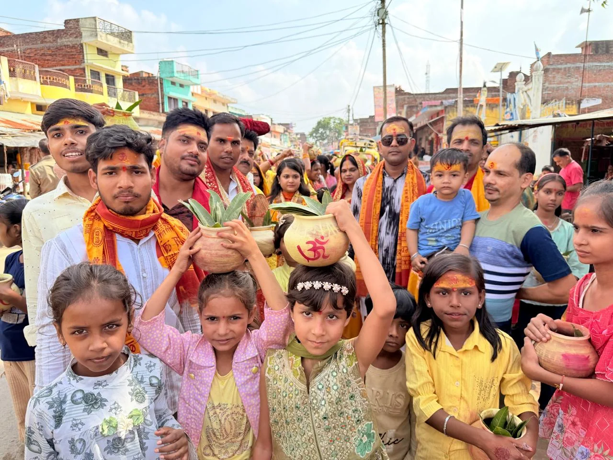

**चन्दौली, उत्तर प्रदेश।** जनपद चन्दौली के नौगढ़ बाजार में श्रीराम कथा का शुभारंभ भक्तिमय माहौल में हुआ। कथा के आयोजन से पहले सुबह 8 बजे भव्य कलश यात्रा निकाली गई, जिसमें महिलाओं और श्रद्धालुओं ने उत्साहपूर्वक भाग लिया। कलश यात्रा के दौरान पूरा क्षेत्र भक्तिमय वातावरण से सराबोर नजर आया।

श्रीराम कथा में कथावाचिका राघव प्रिया जी भगवान श्रीराम के जीवन चरित्र, आदर्शों, मर्यादा और भक्ति से जुड़े प्रसंगों का वर्णन करेंगी। कथा का आयोजन प्रतिदिन रात्रि 7 बजे से 10 बजे तक किया जाएगा, जिसमें श्रद्धालुओं को भगवान श्रीराम की लीलाओं और उनके आदर्शों को सुनने का अवसर मिलेगा।

श्रीराम कथा के शुभारंभ को लेकर नौगढ़ बाजार में श्रद्धा और उत्साह का माहौल बना हुआ है। आयोजकों ने क्षेत्र के समस्त श्रद्धालुओं से कथा में शामिल होकर भगवान श्रीराम की महिमा का श्रवण करने और धर्मलाभ प्राप्त करने की अपील की है।

 **नौगढ़,चन्दौली से अनिल द्विवेदी की रिपोर्ट**
