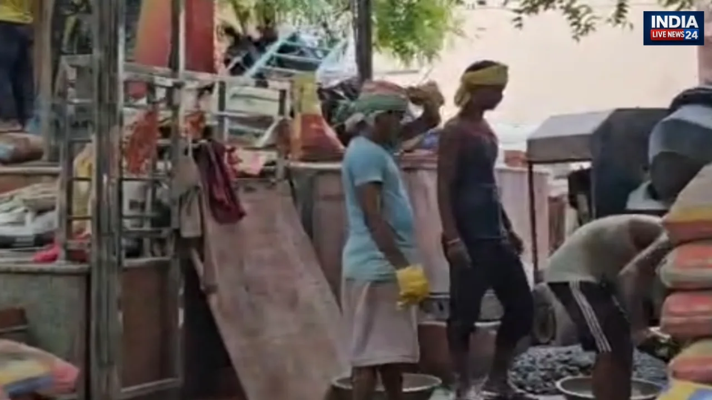

**वाराणसी।** काशी के बड़ी बाजार स्थित श्री शीतला माता एवं सती माता मंदिर की भूमि को लेकर विवाद गहराता नजर आ रहा है। मंदिर पक्ष से जुड़े भक्तजनों, पदाधिकारियों और क्षेत्रीय नागरिकों ने 12 अक्टूबर 2026 को प्रेस वार्ता कर उप जिलाधिकारी सदर द्वारा 16 सितंबर 2026 को पारित आदेश संख्या 163 एवं 164 पर आपत्ति जताई। उन्होंने मामले की निष्पक्ष एवं समयबद्ध जांच कराने और संबंधित आदेशों की समीक्षा करने की मांग की।

प्रेस वार्ता में मंदिर पक्ष की ओर से दावा किया गया कि मोहल्ला जलालुद्दीनपुरा, थाना जैतपुरा क्षेत्र में स्थित आराजी संख्या 478, रकबा 1 बिस्वा 5 धूर की भूमि पर प्राचीनकाल से मां शीतला माता और मां सती का मंदिर मौजूद है। मंदिर पक्ष का कहना है कि यहां लंबे समय से धार्मिक गतिविधियां होती रही हैं और भूमि के ऐतिहासिक महत्व से संबंधित दस्तावेज भी उपलब्ध हैं।

**राजस्व अभिलेखों के आधार पर जांच की मांग**

मंदिर पक्ष ने पुराने राजस्व अभिलेखों और नगर पालिका से संबंधित दस्तावेजों का हवाला देते हुए भूमि की वास्तविक स्थिति की जांच कराने की मांग की। प्रेस विज्ञप्ति में वर्ष 1916 में क्षेत्र के वाराणसी म्युनिसिपल क्षेत्र में शामिल होने और वर्ष 1922 से 1927 के बीच मकान संख्या एन 12/20 के निर्माण का भी उल्लेख किया गया।

प्रेस वार्ता में दावा किया गया कि संबंधित अभिलेखों में शरन लाल पुत्र राम शरन लाल का नाम दर्ज है। मंदिर पक्ष ने प्रशासन से सभी उपलब्ध दस्तावेजों का सत्यापन कराकर भूमि के स्वामित्व और कब्जे से जुड़े तथ्यों को स्पष्ट करने की अपील की।

**लेखपाल की रिपोर्ट पर उठाए सवाल**

मामले में वाद संख्या 2695/2023, अनिल कुमार यादव बनाम अन्य, का उल्लेख करते हुए मंदिर पक्ष ने आरोप लगाया कि स्थानीय लेखपाल की ओर से उचित जांच किए बिना और सभी संबंधित पक्षों को सुनवाई का अवसर दिए बिना रिपोर्ट प्रस्तुत की गई।

मंदिर पक्ष का दावा है कि इसी रिपोर्ट के आधार पर एसडीएम सदर ने 16 सितंबर 2026 को आदेश पारित किए। प्रेस वार्ता में आदेश पारित करने से पहले उपलब्ध साक्ष्यों और मौके की वास्तविक स्थिति की समुचित जांच नहीं किए जाने का भी आरोप लगाया गया।

हालांकि, इन आरोपों की स्वतंत्र पुष्टि नहीं हुई है। संबंधित प्रशासनिक अधिकारियों और दूसरे पक्ष का आधिकारिक पक्ष सामने आने के बाद ही मामले की स्थिति स्पष्ट हो सकेगी।

**समाधि और कब्र को लेकर भी उठाया मुद्दा**

प्रेस वार्ता में मंदिर पक्ष ने समाधि को कब्र बताए जाने को लेकर भी आपत्ति जताई। पक्ष का आरोप है कि इस संबंध में भ्रामक तथ्य प्रस्तुत किए जा रहे हैं। इसके साथ ही आराजी संख्या और विवादित मकान संख्या से जुड़े अलग-अलग मुकदमों का उल्लेख करते हुए पूरे प्रकरण की कानूनी स्थिति स्पष्ट करने की मांग की गई।

मंदिर पक्ष का कहना है कि धार्मिक स्थल से जुड़े विवाद का समाधान ऐतिहासिक दस्तावेजों, राजस्व अभिलेखों और न्यायिक प्रक्रिया के आधार पर किया जाना चाहिए, जिससे किसी भी पक्ष के अधिकार प्रभावित न हों।

**इम्तियाज अहमद की भूमिका की जांच की मांग**

प्रेस वार्ता के दौरान इम्तियाज अहमद नामक व्यक्ति की कथित भूमिका की जांच कराने की मांग भी उठाई गई। प्रेस विज्ञप्ति में आरोप लगाया गया कि उनके कथित हस्तक्षेप से क्षेत्र में विवाद और तनाव की स्थिति पैदा हो सकती है।

मंदिर पक्ष ने प्रशासन से उपलब्ध साक्ष्यों के आधार पर निष्पक्ष जांच कराने और आरोप सिद्ध होने पर नियमानुसार कार्रवाई करने की अपील की। इस संबंध में संबंधित व्यक्ति का पक्ष सामने नहीं आया है और आरोपों की स्वतंत्र पुष्टि भी नहीं हुई है।

**प्रधानमंत्री और मुख्यमंत्री से हस्तक्षेप की अपील**

मंदिर पक्ष ने वाराणसी के सांसद एवं प्रधानमंत्री नरेंद्र मोदी, उत्तर प्रदेश के मुख्यमंत्री योगी आदित्यनाथ और स्थानीय प्रशासन से मामले में हस्तक्षेप करने की अपील की है।

पक्ष की प्रमुख मांगों में एसडीएम सदर के आदेशों की समीक्षा, लेखपाल की रिपोर्ट की निष्पक्ष जांच, सभी संबंधित पक्षों को सुनवाई का उचित अवसर और विवाद का विधि-सम्मत एवं शांतिपूर्ण समाधान शामिल है।

**प्रेस वार्ता में ये लोग रहे मौजूद**

प्रेस वार्ता में प्रमोद केशरी, अनिल यादव, संदीप गुप्ता, सतीश वर्मा, राहुल जायसवाल, हेमंत कुमार बंटी, राहुल गुप्ता, गोकुल गुप्ता, विकास यादव, केशव जायसवाल और अरविंद जायसवाल सहित अन्य पदाधिकारी, पार्षद एवं क्षेत्रीय नागरिक उपस्थित रहे।

मंदिर पक्ष ने प्रशासन से अपील की कि मामले की निष्पक्ष जांच कर उपलब्ध साक्ष्यों और कानूनी तथ्यों के आधार पर निर्णय लिया जाए, ताकि धार्मिक आस्था का सम्मान बना रहे और क्षेत्र में शांति एवं सामाजिक सौहार्द कायम रहे।

**संवाददाता: पवन जायसवाल
इंडिया लाइव न्यूज 24**
