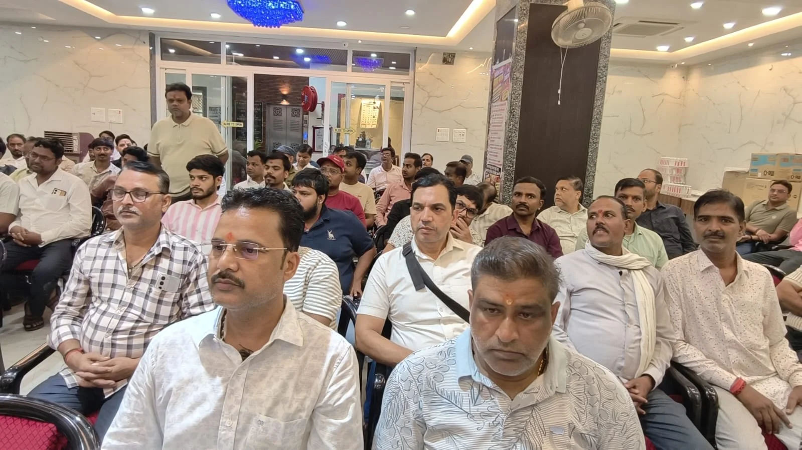
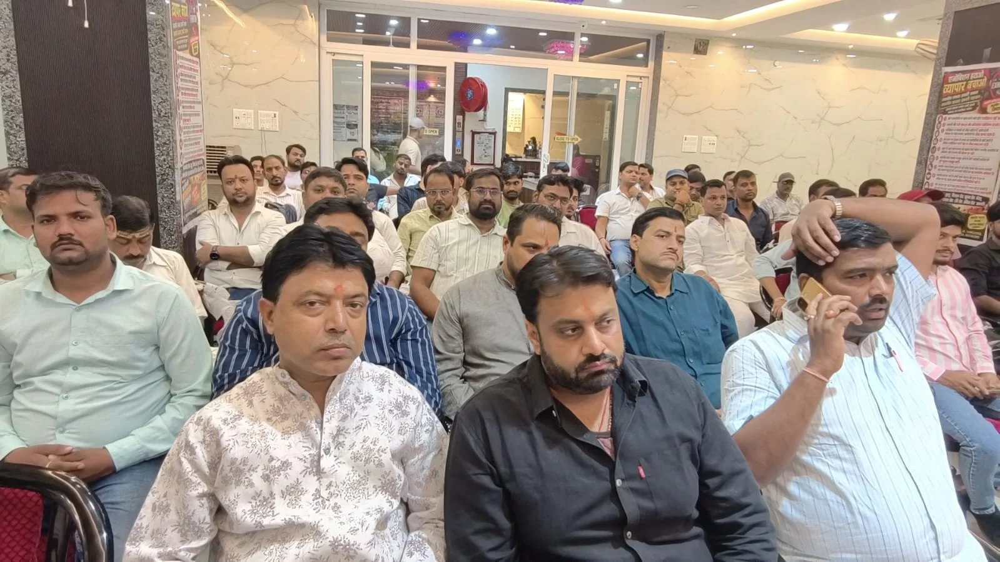

**वाराणसी।** बनारस के स्थानीय सर्राफा व्यापार और पारंपरिक स्वर्णकार कारीगरों के हितों को लेकर प्रस्तावित ज्वेलरी एग्जीबिशन का विरोध तेज होता नजर आ रहा है। स्थानीय व्यापारी और कारीगर इस मुद्दे पर एकजुट होकर अपनी आवाज उठा रहे हैं। उनका कहना है कि एग्जीबिशन की व्यवस्था में स्थानीय कारोबारियों और पारंपरिक कारीगरों को पर्याप्त अवसर नहीं मिलने से उनके व्यापार और आजीविका पर असर पड़ने की आशंका है। इस संबंध में व्यापारी जल्द ही जिलाधिकारी को ज्ञापन सौंपकर हस्तक्षेप की मांग करेंगे।

**एग्जीबिशन की व्यवस्था और नियमों पर उठाए सवाल**

व्यापारियों एवं कारीगरों ने ज्वेलरी एग्जीबिशन में खरीद-बिक्री की प्रक्रिया, व्यापारिक नियमों के पालन और स्थानीय कारोबारियों की भागीदारी को लेकर सवाल उठाए हैं। उनकी मांग है कि एग्जीबिशन में लागू नियमों का पारदर्शी तरीके से पालन हो और छोटे व्यापारियों तथा स्थानीय कारीगरों को भी उचित अवसर मिले।

व्यापारियों का कहना है कि उनका विरोध किसी व्यक्ति विशेष या संस्था के खिलाफ नहीं, बल्कि बनारस के स्थानीय व्यापार और उससे जुड़े परिवारों की आजीविका की रक्षा के लिए है।

**स्थानीय सर्राफा कारोबार पर असर की आशंका**

व्यापारियों ने सोने की खरीदारी को लेकर प्रधानमंत्री की अपील के प्रभाव पर भी चिंता जताई है। उनका कहना है कि यदि सोने की खरीदारी में कमी आती है या ग्राहकों के खरीदारी संबंधी फैसलों में बदलाव होता है, तो इसका असर सर्राफा कारोबार और आभूषण निर्माण से जुड़े कारीगरों की आय पर पड़ सकता है।

ऐसे में व्यापारियों को आशंका है कि स्थानीय बाजार पर अतिरिक्त प्रतिस्पर्धा का दबाव बढ़ने से छोटे कारोबारियों और पारंपरिक स्वर्णकारों की मुश्किलें बढ़ सकती हैं।

**डीएम को ज्ञापन, जरूरत पड़ी तो प्रदेश सरकार तक पहुंचेगा मामला**

अभियान से जुड़े व्यापारियों ने स्पष्ट किया है कि वे अपनी मांगों को लोकतांत्रिक और शांतिपूर्ण तरीके से शासन-प्रशासन के सामने रखेंगे। इसी क्रम में जिलाधिकारी को ज्ञापन सौंपकर स्थानीय सर्राफा व्यापार और कारीगरों के हितों की रक्षा के लिए आवश्यक कदम उठाने की मांग की जाएगी। व्यापारियों का कहना है कि जरूरत पड़ने पर इस मुद्दे को प्रदेश सरकार के समक्ष भी उठाया जाएगा।

**बनारस की पारंपरिक सर्राफा मंडी की पहचान बचाने की मांग**

व्यापारियों के मुताबिक, बनारस की सर्राफा मंडी केवल खरीद-बिक्री का केंद्र नहीं, बल्कि पारंपरिक स्वर्ण कला और पीढ़ियों से चली आ रही कारीगरी की पहचान भी है। इस कारोबार से जुड़े परिवारों की आजीविका स्थानीय बाजार पर निर्भर है। ऐसे में व्यापारियों का कहना है कि स्थानीय कारोबार को सुरक्षित रखने के साथ पारंपरिक कारीगरों को भी आगे बढ़ने के अवसर मिलने चाहिए।

**इन लोगों के नेतृत्व में चल रहा अभियान**

प्रेस विज्ञप्ति के अनुसार, अभियान का नेतृत्व नवनीत सर्राफ, किशन सेठ स्वर्णकार, शुभम सेठ ‘गोलू’, अमन सर्राफ और सूरज दयाल सेठ कर रहे हैं। इस मुहिम को काशी सर्राफा मंडल, उत्तर प्रदेश स्वर्णकार संघ और सोनार नरहरी सेना का समर्थन मिलने की बात कही गई है।

अभियान से जुड़े लोगों ने पत्रकारों, जनप्रतिनिधियों और शासन-प्रशासन से स्थानीय सर्राफा व्यापार तथा कारीगरों की समस्याओं पर गंभीरता से विचार करने की अपील की है। उनका कहना है कि स्थानीय व्यापार को मजबूती मिलेगी, तभी पारंपरिक कारीगरों और उनसे जुड़े परिवारों की आजीविका सुरक्षित रह सकेगी।

व्यापारियों का संदेश है कि उनकी लड़ाई किसी व्यक्ति से नहीं, बल्कि बनारस की पारंपरिक सर्राफा मंडी की पहचान और स्थानीय कारीगरों की रोजी-रोटी बचाने के लिए है।

**संवाददाता - पवन जायसवाल**
