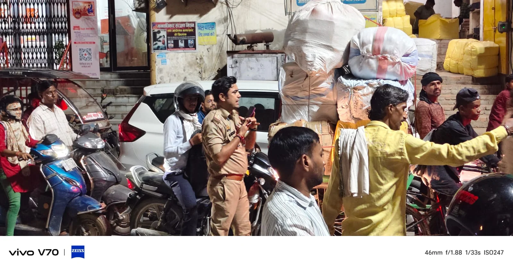

**वाराणसी।** त्योहारों के चलते बाजारों में बढ़ी भीड़ के कारण बेनिया से कबीरचौरा तक भीषण जाम लग गया। वाहनों की लंबी कतारों से राहगीरों और वाहन चालकों को परेशानी का सामना करना पड़ा। सूचना मिलते ही चौक पुलिस सक्रिय हुई और यातायात व्यवस्था सुचारु कराने में जुट गई।

थाना प्रभारी विजय कुमार शुक्ला के नेतृत्व में पियरी चौकी प्रभारी विकास मिश्रा ने मौके पर पहुंचकर स्वयं यातायात की कमान संभाली। 

उन्होंने वाहनों को व्यवस्थित कराते हुए जाम खुलवाने के लिए आवश्यक कदम उठाए। पुलिस की सक्रियता से कुछ ही मिनटों में यातायात की स्थिति में सुधार हुआ और जाम में फंसे लोगों को राहत मिली।

त्योहारों के दौरान वाराणसी के प्रमुख बाजारों और व्यस्त मार्गों पर भीड़ बढ़ने से यातायात का दबाव भी बढ़ जाता है। ऐसे में चौक पुलिस की तत्परता से लोगों को राहत मिली। पुलिस का प्रयास है कि त्योहारों के दौरान सुरक्षा व्यवस्था के साथ यातायात भी सुचारु बना रहे।

**रिपोर्ट: ए. जावेद**
