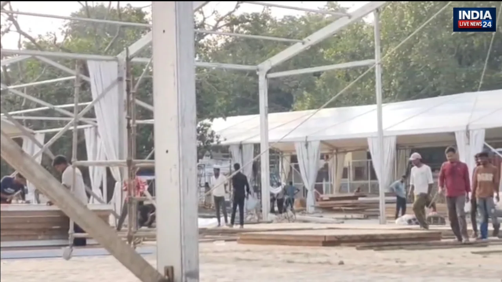

**वाराणसी।** धर्मनगरी काशी में गंगा के ऊपर 22, 24 और 25 अक्टूबर को प्रस्तावित एयर शो को लेकर प्रशासन ने तैयारियां तेज कर दी हैं। प्रधानमंत्री नरेंद्र मोदी समेत विशिष्ट अतिथियों के संभावित आगमन को देखते हुए नमो घाट और आसपास के इलाकों में सुरक्षा व्यवस्था मजबूत की जा रही है। एयर फोर्स और पुलिस प्रशासन के अधिकारियों ने नमो घाट का निरीक्षण कर सुरक्षा, यातायात और भीड़ प्रबंधन से जुड़ी तैयारियों का जायजा लिया।

**21 से 25 अक्टूबर तक नमो घाट पर आम लोगों की आवाजाही बंद**

एयर शो के मद्देनजर 21 से 25 अक्टूबर तक नमो घाट पर आम लोगों की आवाजाही बंद रखने की व्यवस्था की गई है। घाट तक पहुंचने के लिए तीन पक्के रास्ते तैयार किए जा रहे हैं। इनमें बसंत महिला महाविद्यालय के अंदर से हेलीपैड की ओर जाने वाला मार्ग, लाल खां रोजा की बाउंड्री से सटे नमो घाट के फेस-3 में शाही नाले के पास से हेलीपैड तक जाने वाला रास्ता और आदिकेशव घाट से नमो घाट तक पहुंचने वाला मार्ग शामिल है।

**गंगा किनारे तीन स्तरों पर होगी बैरिकेडिंग**

एयर शो के दौरान सुरक्षा को ध्यान में रखते हुए अस्सी घाट से नमो घाट तक गंगा किनारे तीन स्तरों पर बैरिकेडिंग की जा रही है। इसका उद्देश्य लोगों को नदी के पानी तक पहुंचने से रोकना और भीड़ को नियंत्रित रखना है।

प्रशासन के अनुसार, रामनगर से डोमरी, सूजाबाद और बहादुरपुर तक करीब छह किलोमीटर क्षेत्र में बैरिकेडिंग का काम पूरा हो चुका है। आयोजन के दौरान गंगा स्नान पर भी प्रतिबंध रहेगा। सुरक्षा व्यवस्था में पुलिस, पीएसी, एनडीआरएफ और जल पुलिस की टीमें तैनात रहेंगी।

**हर 150 मीटर पर बनेगा पुलिस सहायता केंद्र**

एयर शो के दौरान श्रद्धालुओं और आम नागरिकों की सहायता के लिए हर 150 मीटर पर पुलिस सहायता केंद्र बनाए गए हैं। इन केंद्रों के माध्यम से लोग खोया-पाया सहित अन्य समस्याओं की सूचना दे सकेंगे। पुलिसकर्मियों और संबंधित विभागों के कर्मचारियों को लोगों की सहायता तथा शिकायतों के समाधान के लिए तैनात किया जाएगा।

**सेना के हेलीकॉप्टरों के लिए रिजर्व रहेगा मल्टी मॉडल टर्मिनल**

एयर शो की तैयारियों के तहत रामनगर स्थित मल्टी मॉडल टर्मिनल के प्लेटफॉर्म को सेना के हेलीकॉप्टरों के लिए रिजर्व रखने की व्यवस्था की गई है। आवश्यकता और परिस्थितियों के अनुसार यहां हेलीकॉप्टर उतारे जा सकते हैं।

वहीं, रामनगर से पड़ाव की ओर टेंट सिटी रोड, डोमरी स्थित सतुआ बाबा आश्रम मार्ग और सूजाबाद पुलिस चौकी के सामने से पैदल आवागमन की व्यवस्था की जाएगी, ताकि लोगों की आवाजाही को व्यवस्थित रखा जा सके।

**गंगा किनारे 12 अस्थायी अस्पताल, एंबुलेंस भी रहेंगी तैयार**

आयोजन के दौरान किसी भी स्वास्थ्य संबंधी आपात स्थिति से निपटने के लिए गंगा किनारे 12 अस्थायी अस्पताल बनाए गए हैं। इन अस्पतालों में चिकित्सकों के साथ आवश्यक दवाओं की उपलब्धता सुनिश्चित की जाएगी।

गंभीर स्थिति में मरीजों को एंबुलेंस के माध्यम से रामनगर स्थित लाल बहादुर शास्त्री अस्पताल पहुंचाया जाएगा। इसके लिए अस्पताल के इमरजेंसी वार्ड में आठ बेड रिजर्व रखने की व्यवस्था की गई है।

**सुरक्षा, यातायात और भीड़ नियंत्रण पर विशेष नजर**

एयर शो को सफलतापूर्वक संपन्न कराने के लिए प्रशासन सुरक्षा, यातायात प्रबंधन, भीड़ नियंत्रण और आपातकालीन चिकित्सा सुविधाओं पर विशेष ध्यान दे रहा है। नमो घाट और गंगा किनारे के संवेदनशील क्षेत्रों में सुरक्षा व्यवस्था मजबूत की जा रही है।

प्रशासन की प्राथमिकता आयोजन के दौरान निर्धारित प्रतिबंधों का पालन सुनिश्चित कराना, लोगों की सुरक्षा बनाए रखना और किसी भी आपात स्थिति से निपटने के लिए तैयार रहना है।

**संवाददाता: पवन जायसवाल**
