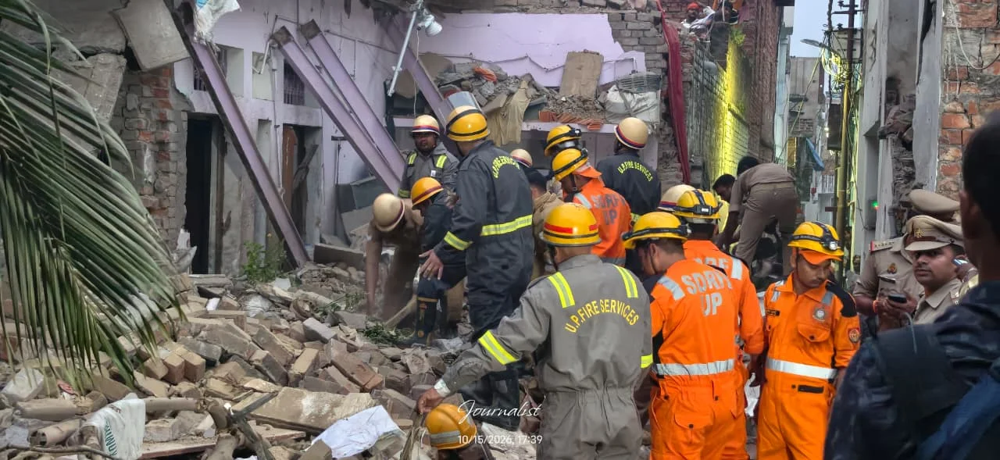
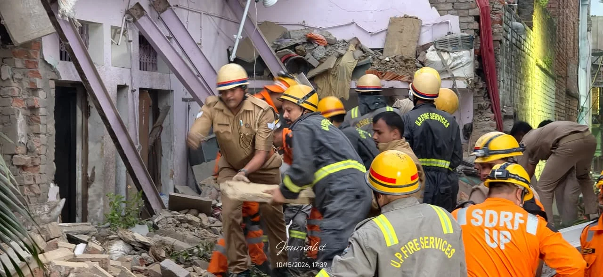

**वाराणसी।** धर्मनगरी काशी के सारनाथ थाना क्षेत्र स्थित पैगम्बरपुर में गुरुवार शाम एक जोरदार धमाके से पूरा इलाका दहल उठा। धमाका इतना तेज था कि एक मकान पूरी तरह ढह गया, जबकि आसपास के करीब दस घरों तक इसका असर पहुंचने की जानकारी सामने आई है। धमाके के कारण कई घरों के शीशे और फर्नीचर टूटने की भी सूचना है। घटना के बाद इलाके में अफरा-तफरी और दहशत का माहौल बन गया।

**धमाके से ढहा मकान, आसपास के घरों को भी नुकसान**

प्रारंभिक जानकारी के अनुसार, पैगम्बरपुर में राजू खान के मकान में गुरुवार शाम करीब 4:30 बजे विस्फोट हुआ। धमाके की आवाज सुनकर आसपास के लोग सहम गए और घटनास्थल पर लोगों की भीड़ जुट गई। विस्फोट की तीव्रता का अंदाजा इसी बात से लगाया जा रहा है कि मकान ढहने के साथ आसपास के घरों में भी नुकसान होने की सूचना मिली है।

**बम बनाए जाने की आशंका, कारणों की पुष्टि नहीं**

घटना को लेकर प्रारंभिक स्तर पर आशंका जताई जा रही है कि मकान में कथित तौर पर बम बनाए जाने के दौरान विस्फोट हुआ होगा। हालांकि, अभी तक विस्फोट के वास्तविक कारणों की आधिकारिक पुष्टि नहीं हुई है। ऐसे में घटना के पीछे की वजह को लेकर स्थिति स्पष्ट होना बाकी है।

**घायलों और नुकसान को लेकर आधिकारिक जानकारी का इंतजार**

इस धमाके में कितने लोग घायल हुए हैं या किसी की जान गई है, इसकी फिलहाल पुष्टि नहीं हो सकी है। मकान में मौजूद लोगों की स्थिति, विस्फोट से हुए नुकसान और घटना के कारणों को लेकर विस्तृत जानकारी सामने आना बाकी है।

रिहायशी इलाके में हुए इस बड़े धमाके ने कई सवाल खड़े कर दिए हैं। क्या यह विस्फोट वास्तव में बम बनाए जाने के दौरान हुआ या इसकी कोई दूसरी वजह है? इसका खुलासा जांच के बाद ही हो सकेगा।

फिलहाल घटना से जुड़ी आधिकारिक पुष्टि और जांच के निष्कर्षों का इंतजार है।

**संवाददाता - पवन जायसवाल**
