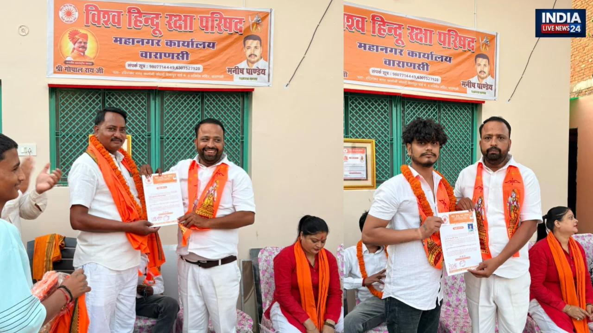

**वाराणसी।** विश्व हिंदू रक्षा परिषद ने वाराणसी में संगठन को मजबूत बनाने की दिशा में महानगर कार्यकारिणी का विस्तार किया। महानगर अध्यक्ष मनीष पाण्डे की अध्यक्षता में आयोजित कार्यक्रम के दौरान नवनियुक्त पदाधिकारियों को नियुक्ति पत्र सौंपकर उनका स्वागत एवं अभिनंदन किया गया। इस अवसर पर संगठन की गतिविधियों को विस्तार देने और सामाजिक कार्यों में सक्रिय भागीदारी सुनिश्चित करने पर जोर दिया गया।

कार्यक्रम में अजय राजभर को महानगर उपाध्यक्ष तथा बबलू गुप्ता को विधानसभा अध्यक्ष की जिम्मेदारी सौंपी गई। इसके साथ ही अन्य सदस्यों को भी संगठन में शामिल कर विभिन्न दायित्व प्रदान किए गए। नवनियुक्त पदाधिकारियों से संगठन की नीतियों एवं उद्देश्यों को आगे बढ़ाने और समाजहित से जुड़े कार्यों में सक्रिय भूमिका निभाने की अपेक्षा जताई गई।

**महिला सशक्तिकरण और संगठन की मजबूती पर जोर**

कार्यक्रम के दौरान संगठन में महिलाओं की भागीदारी और महिला सशक्तिकरण के महत्व पर भी चर्चा की गई। इस मौके पर मौजूद रानी चौबे और सुनीता जायसवाल ने नवनियुक्त पदाधिकारियों को बधाई एवं शुभकामनाएं दीं। उन्होंने उम्मीद जताई कि सभी पदाधिकारी अपनी जिम्मेदारियों का निर्वहन निष्ठा, ईमानदारी और समर्पण के साथ करेंगे।

बैठक में संगठन के विस्तार, आपसी समन्वय और सामाजिक गतिविधियों को अधिक प्रभावी बनाने जैसे विषयों पर भी चर्चा हुई। कार्यकारिणी विस्तार को संगठन की सक्रियता बढ़ाने और जनहित से जुड़े कार्यों में भागीदारी मजबूत करने की पहल के रूप में देखा जा रहा है।

**समाजहित में कार्य करने का लिया संकल्प**

नवनियुक्त पदाधिकारियों ने संगठन की ओर से सौंपी गई जिम्मेदारियों को पूरी निष्ठा के साथ निभाने और समाजहित में कार्य करने का संकल्प व्यक्त किया। कार्यक्रम के माध्यम से संगठनात्मक एकजुटता और सामाजिक गतिविधियों को आगे बढ़ाने का संदेश दिया गया।

**रिपोर्ट: ए. जावेद**
