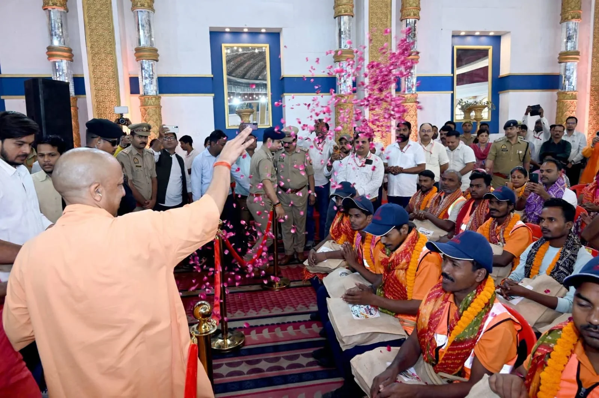

**वाराणसी।** उत्तर प्रदेश के मुख्यमंत्री योगी आदित्यनाथ ने वाराणसी में सफाई कर्मियों के सम्मान समारोह में उनके योगदान की सराहना करते हुए समाज को महत्वपूर्ण संदेश दिया। पिपलानी कटरा स्थित सरोजा पैलेस में आयोजित कार्यक्रम के दौरान मुख्यमंत्री ने कहा कि यदि किसी का सम्मान करना है, तो सबसे पहले सफाई कर्मियों का सम्मान कीजिए। शहर को स्वच्छ और व्यवस्थित बनाए रखने में उनकी भूमिका बेहद महत्वपूर्ण है।

मुख्यमंत्री योगी आदित्यनाथ ने कहा कि सफाई कर्मी ऐसे समय में अपने कर्तव्यों का निर्वहन करते हैं, जब अधिकांश लोग अपने घरों में सो रहे होते हैं। वे सुबह होने से पहले ही सड़कों पर उतरकर शहर की सफाई में जुट जाते हैं, ताकि लोगों को स्वच्छ वातावरण मिल सके।

**गर्मी, ठंड और बरसात में भी निभाते हैं जिम्मेदारी**

सीएम योगी ने सफाई कर्मियों की मेहनत और कठिन परिस्थितियों में काम करने के जज्बे को रेखांकित किया। उन्होंने कहा कि तेज धूप, कड़ाके की ठंड और बारिश जैसी परिस्थितियों में भी सफाई कर्मी लगातार काम करते हैं। उनके परिश्रम से ही शहरों में स्वच्छता व्यवस्था बनाए रखने में मदद मिलती है।

मुख्यमंत्री ने अपने संबोधन में स्पष्ट किया कि सफाई कर्मियों की सेवाओं को नजरअंदाज नहीं किया जाना चाहिए। वे समाज के लिए महत्वपूर्ण जिम्मेदारी निभाते हैं और उनके योगदान को उचित सम्मान मिलना चाहिए।

**सफाई कर्मियों के सम्मान का दिया संदेश**

मुख्यमंत्री योगी आदित्यनाथ ने कहा कि वह जब भी किसी नगर निगम या प्रदेश के किसी क्षेत्र में जाते हैं, तो सफाई कर्मियों के सम्मान पर विशेष जोर देते हैं। उन्होंने समाज के सभी वर्गों से अपील की कि स्वच्छता कर्मियों के काम और उनकी सेवा भावना को पहचानें तथा उनके प्रति सम्मान का भाव रखें।

कार्यक्रम के माध्यम से मुख्यमंत्री ने स्वच्छता कर्मियों के परिश्रम, समर्पण और सामाजिक योगदान को रेखांकित किया। उनका संदेश साफ था कि स्वच्छ शहर बनाने में जुटे इन कर्मियों का सम्मान करना पूरे समाज की जिम्मेदारी है।

**संवाददाता: पवन जायसवाल**
