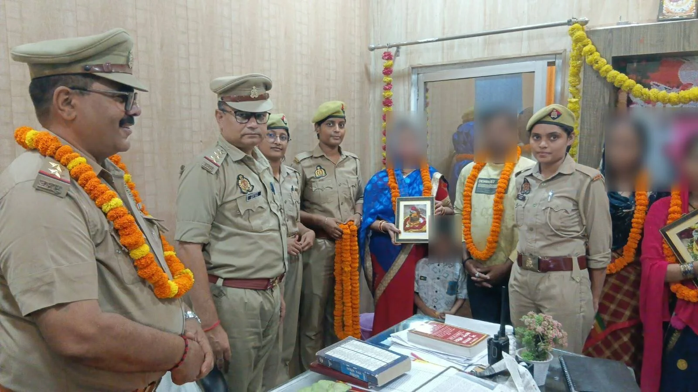
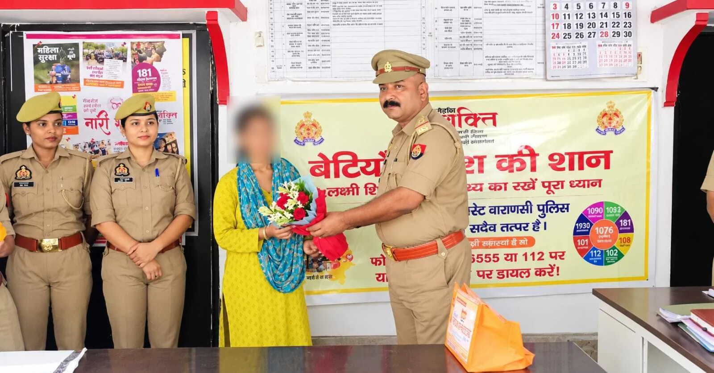

**वाराणसी।** उत्तर प्रदेश सरकार के मिशन शक्ति 6.0 अभियान के तहत वाराणसी के सिगरा थाना परिसर में महिलाओं के सम्मान और सशक्तीकरण को लेकर विशेष कार्यक्रम आयोजित किया गया। थाना प्रभारी निरीक्षक शिवाकांत मिश्रा के नेतृत्व में आयोजित इस कार्यक्रम में उन महिलाओं को सम्मानित किया गया, जिनके पारिवारिक विवादों का पुलिस की मिशन शक्ति टीम ने आपसी बातचीत और समझाइश के माध्यम से समाधान कराया था।

कार्यक्रम के दौरान महिलाओं को पुष्पगुच्छ, गुलाब के फूल, अंगवस्त्र और मिठाई भेंट कर सम्मानित किया गया। साथ ही मिशन शक्ति के पंपलेट वितरित कर उन्हें महिला सुरक्षा, अधिकारों और स्वावलंबन के प्रति जागरूक किया गया।

पुलिस के अनुसार, मिशन शक्ति टीम ने पिछले वर्ष कई पारिवारिक विवादों को संवाद और आपसी समझ-बूझ के जरिए सुलझाने में महत्वपूर्ण भूमिका निभाई थी। विवादों का समाधान होने के बाद संबंधित महिलाएं अपने परिजनों के साथ शांतिपूर्ण जीवन व्यतीत कर रही हैं। इन्हीं महिलाओं को कार्यक्रम में आमंत्रित कर उनके जीवन में सकारात्मक बदलाव लाने के प्रयासों को सम्मान दिया गया।

**महिला सुरक्षा और सम्मान का दिया संदेश**

कार्यक्रम के माध्यम से महिलाओं को सुरक्षा, सम्मान और आत्मनिर्भरता के प्रति जागरूक करने के साथ ही समाज में पारिवारिक सौहार्द बनाए रखने का संदेश दिया गया। पुलिस टीम ने महिलाओं को भरोसा दिलाया कि उनकी समस्याओं के समाधान और उन्हें सुरक्षित वातावरण उपलब्ध कराने के लिए पुलिस निरंतर प्रयास करती रहेगी।

**मिशन शक्ति के तहत महिलाओं को सशक्त बनाने की पहल**

मिशन शक्ति 6.0 अभियान के अंतर्गत वाराणसी पुलिस महिलाओं और बालिकाओं की सुरक्षा, उनके अधिकारों के प्रति जागरूकता, पारिवारिक विवादों के सौहार्दपूर्ण समाधान और महिला सशक्तीकरण की दिशा में विभिन्न कार्यक्रम आयोजित कर रही है। सिगरा पुलिस की यह पहल महिला सम्मान और सामाजिक सौहार्द को बढ़ावा देने की दिशा में एक महत्वपूर्ण कदम है।

**रिपोर्ट: नजर खान**
