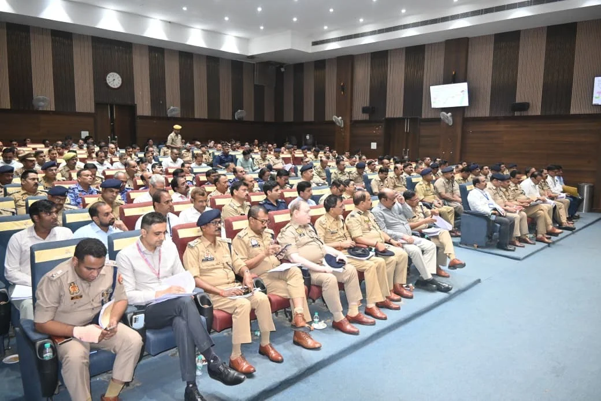

**वाराणसी।** प्रधानमंत्री के आगमन एवं भ्रमण और 24 व 25 अक्टूबर 2026 को आयोजित होने वाले भव्य एयर शो को लेकर वाराणसी पुलिस कमिश्नरेट पूरी तरह अलर्ट मोड में है। सुरक्षा व्यवस्था को पुख्ता बनाने के लिए पुलिस आयुक्त मोहित अग्रवाल ने शुक्रवार, 23 अक्टूबर को ड्यूटी में तैनात पुलिस अधिकारियों और कर्मचारियों की ब्रीफिंग कर आवश्यक दिशा-निर्देश दिए। उन्होंने स्पष्ट किया कि वीवीआईपी सुरक्षा से लेकर यातायात और भीड़ प्रबंधन तक किसी भी स्तर पर लापरवाही बर्दाश्त नहीं की जाएगी।

**वीवीआईपी रूट और कार्यक्रम स्थल पर कड़ी निगरानी**

पुलिस आयुक्त ने सभी अधिकारियों और कर्मचारियों को निर्धारित समय से पहले ड्यूटी स्थल पर पहुंचने और पूरी सतर्कता के साथ अपनी जिम्मेदारी निभाने के निर्देश दिए। वीवीआईपी रूट, कार्यक्रम स्थल, प्रमुख चौराहों और संवेदनशील स्थानों पर पर्याप्त पुलिस बल की तैनाती सुनिश्चित करने को कहा गया है। साथ ही, क्षेत्रीय अधिकारियों को लगातार निरीक्षण कर सुरक्षा व्यवस्था की निगरानी करने के निर्देश दिए गए।

**ड्रोन और सीसीटीवी से होगी निगरानी**

एयर शो के दौरान सुरक्षा व्यवस्था मजबूत रखने के लिए संवेदनशील स्थानों पर रूफटॉप ड्यूटी लगाई जाएगी। कार्यक्रम स्थल, वीवीआईपी मार्ग और भीड़भाड़ वाले क्षेत्रों की निगरानी ड्रोन और सीसीटीवी कैमरों के माध्यम से की जाएगी।

इसके अलावा होटल, ढाबे, गेस्ट हाउस और अन्य ठहरने वाले स्थानों की जांच एवं आवश्यक सत्यापन करने के निर्देश दिए गए हैं। किसी भी संदिग्ध व्यक्ति, वस्तु या गतिविधि की जानकारी मिलने पर तत्काल संबंधित अधिकारियों को सूचित कर कार्रवाई सुनिश्चित करने को कहा गया है।

**यातायात और पार्किंग व्यवस्था पर विशेष फोकस**

एयर शो में बड़ी संख्या में दर्शकों के पहुंचने की संभावना को देखते हुए यातायात प्रबंधन पर विशेष ध्यान दिया जा रहा है। यातायात पुलिस को आवश्यकता के अनुसार डायवर्जन लागू करने, वैकल्पिक मार्गों का उपयोग सुनिश्चित कराने और प्रमुख चौराहों, कट तथा गलियों में पर्याप्त पुलिस बल तैनात करने के निर्देश दिए गए हैं।

निर्धारित पार्किंग स्थलों पर वाहनों की सुव्यवस्थित पार्किंग, दिशा-सूचक बोर्ड लगाने और प्रवेश एवं निकास मार्गों को व्यवस्थित रखने पर जोर दिया गया है। साथ ही, आपातकालीन मार्गों को बाधामुक्त रखने और बैरिकेडिंग के जरिए भीड़ को नियंत्रित करने के निर्देश दिए गए हैं।

**महिला दर्शकों की सुरक्षा के लिए विशेष इंतजाम**

पुलिस आयुक्त ने दर्शकों की सुरक्षा और सुविधा को प्राथमिकता देते हुए प्रत्येक दर्शक इनक्लोजर में महिला पुलिसकर्मियों की तैनाती सुनिश्चित करने को कहा है। इससे महिला दर्शकों को जरूरत पड़ने पर तत्काल सहायता उपलब्ध कराई जा सकेगी।

उन्होंने पुलिसकर्मियों को आमजन के साथ विनम्र, शालीन और सम्मानजनक व्यवहार करने की हिदायत दी। लोगों को रास्ता बताने, जरूरी जानकारी उपलब्ध कराने और हर संभव सहायता देने के निर्देश भी दिए गए। भीड़ नियंत्रण के दौरान संयम बरतने और अनावश्यक बल प्रयोग से बचने पर विशेष जोर दिया गया।

**प्रवेश द्वारों पर होगी सघन जांच**

कार्यक्रम स्थल के सभी प्रवेश द्वारों पर निर्धारित सुरक्षा प्रोटोकॉल के तहत जांच और फ्रिस्किंग की जाएगी। बिना सुरक्षा जांच किसी को प्रवेश नहीं दिया जाएगा। महिला दर्शकों की जांच महिला पुलिसकर्मियों द्वारा ही की जाएगी। प्रवेश और निकास बिंदुओं पर सतर्क निगरानी रखते हुए भीड़ का सुचारु संचालन सुनिश्चित करने के निर्देश दिए गए हैं।

**वायरलेस सेट के साथ मुस्तैद रहेंगे पुलिसकर्मी**

ड्यूटी पर तैनात सभी पुलिस अधिकारियों और कर्मचारियों को वायरलेस सेट उपलब्ध रखने तथा किसी भी सूचना पर तत्काल कार्रवाई करने के निर्देश दिए गए हैं। ड्यूटी के दौरान मोबाइल फोन का अनावश्यक इस्तेमाल न करने और सुरक्षा व्यवस्था पर पूरा ध्यान केंद्रित रखने को कहा गया है। किसी भी आपात स्थिति से निपटने के लिए आपसी समन्वय और त्वरित रिस्पॉन्स सुनिश्चित करने पर भी जोर दिया गया।

**सुरक्षा में लापरवाही पर होगी कार्रवाई**

पुलिस आयुक्त मोहित अग्रवाल ने स्पष्ट किया कि प्रधानमंत्री के आगमन और एयर शो के दौरान सुरक्षा व्यवस्था में किसी भी प्रकार की शिथिलता स्वीकार नहीं की जाएगी। सभी अधिकारी अपने निर्धारित क्षेत्रों में भ्रमणशील रहकर व्यवस्थाओं का निरीक्षण करेंगे और किसी भी आपात परिस्थिति में पूर्व निर्धारित कार्ययोजना के अनुसार तत्काल कार्रवाई करेंगे।

पुलिस कमिश्नरेट का उद्देश्य वीवीआईपी सुरक्षा के साथ-साथ आमजन का सुरक्षित आवागमन, सुचारु यातायात, प्रभावी भीड़ प्रबंधन और दर्शकों को बेहतर सुविधा उपलब्ध कराना है। पुलिस प्रशासन ने सभी अधिकारियों एवं कर्मचारियों को पूरी सतर्कता, जिम्मेदारी और आपसी समन्वय के साथ ड्यूटी निभाने के निर्देश दिए हैं, ताकि एयर शो और प्रधानमंत्री का कार्यक्रम सुरक्षित एवं व्यवस्थित ढंग से संपन्न कराया जा सके।

**रिपोर्ट: ए. जावेद**
