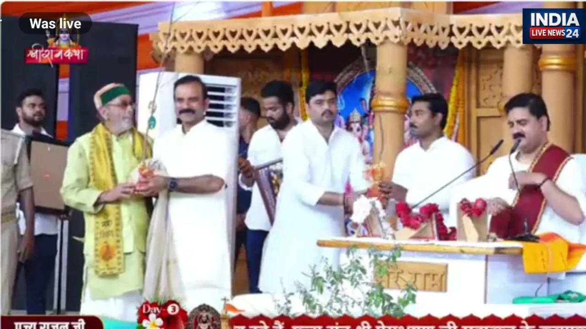

**चंदौली।** जनपद चंदौली के धानापुर में विधायक सुशील सिंह द्वारा आयोजित श्रीराम कथा के तीसरे दिन पर्यावरण संरक्षण और सत्संग की महत्ता का अनूठा संदेश देखने को मिला। वृक्ष बंधु डॉ. परशुराम सिंह ने कथा व्यास पंडित राजन जी महाराज को नीम का पौधा भेंट कर प्रकृति संरक्षण के प्रति जागरूकता का संदेश दिया। उनकी इस अनूठी पहल की कथा में मौजूद श्रद्धालुओं के बीच खूब चर्चा रही।

डॉ. परशुराम सिंह ने नीम के वृक्ष का उदाहरण देते हुए कहा कि मनुष्य के जीवन में भी नीम की पत्तियों की तरह कड़वाहट और अनेक अवगुण होते हैं, लेकिन जिस प्रकार नीम अपने औषधीय गुणों के कारण मानव जीवन के लिए उपयोगी है, उसी प्रकार मनुष्य भी संतों के सानिध्य में रहकर अपने अवगुणों को दूर कर सकता है। सत्संग व्यक्ति के विचारों और आचरण को बेहतर बनाने में महत्वपूर्ण भूमिका निभाता है।

नीम का पौधा भेंट किए जाने पर कथा व्यास पंडित राजन जी महाराज ने प्रसन्नता व्यक्त की। उन्होंने कहा कि उन्होंने अब तक अनेक कथाएं की हैं, लेकिन इस तरह की अनूठी भेंट उन्हें पहली बार मिली है। उन्होंने नीम के वृक्ष को जीवन और प्रकृति के लिए महत्वपूर्ण बताते हुए कहा कि इस प्रकार की पहल पर्यावरण संरक्षण के प्रति लोगों को जागरूक करने का प्रभावी माध्यम है।

श्रीराम कथा के दौरान पौधा भेंट करने की इस पहल ने श्रद्धालुओं को आध्यात्मिकता के साथ प्रकृति के प्रति अपने दायित्वों का भी संदेश दिया। इस अवसर पर यह प्रेरणा दी गई कि जिस प्रकार संतों का सानिध्य मनुष्य के जीवन को सकारात्मक दिशा देता है, उसी प्रकार वृक्षों का संरक्षण पृथ्वी और मानव जीवन को स्वस्थ बनाए रखने में अहम भूमिका निभाता है।

वहीं, विधायक सुशील सिंह ने डॉ. परशुराम सिंह की इस पहल के लिए उनका आभार व्यक्त किया। यह पहल धार्मिक आयोजनों के माध्यम से पर्यावरण संरक्षण का संदेश जन-जन तक पहुंचाने की दिशा में एक सराहनीय प्रयास बनी।

**रिपोर्ट -अनिल द्विवेदी**
