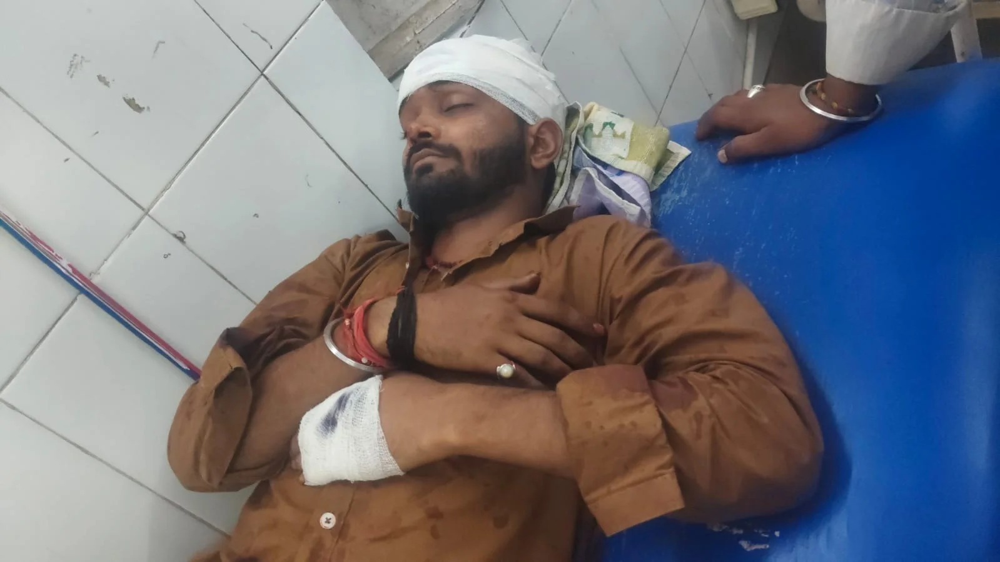

**वाराणसी।** धर्म और संस्कृति की नगरी काशी में अपराधियों के हौसले बुलंद होने के आरोपों के बीच टकटकपुर स्थित राधापुरम कॉलोनी के निवासी रवि यादव पर कथित जानलेवा हमले का मामला सामने आया है। पीड़ित पक्ष के मुताबिक, महावीर मंदिर के पास केनरा बैंक मोड़ स्थित पंकज पाल की पान की दुकान पर बैठे रवि यादव पर 17 से 18 लोगों ने हमला कर दिया। 

आरोप है कि हमलावरों के पास लोहे की रॉड, चाकू और अवैध असलहे थे। हमले में रवि यादव गंभीर रूप से घायल हो गए। सिर में चोट लगने के बाद उन्हें उपचार के लिए ट्रॉमा सेंटर रेफर किया गया।

इस घटना ने एक बार फिर कैंट थाना क्षेत्र में पुलिस की गश्त, सार्वजनिक स्थानों पर सुरक्षा व्यवस्था और अपराधियों के खिलाफ प्रभावी कार्रवाई को लेकर सवाल खड़े कर दिए हैं।

**पान की दुकान पर अचानक पहुंचे हमलावर, युवक को बेरहमी से पीटने का आरोप**

पीड़ित पक्ष से प्राप्त जानकारी के अनुसार, घटना की रात रवि यादव महावीर मंदिर के पास केनरा बैंक मोड़ पर स्थित पंकज पाल की पान की दुकान पर बैठे थे। उस समय वह दुकानदार पंकज पाल के बेटे राजू पाल से बातचीत कर रहे थे।

आरोप है कि इसी दौरान 17 से 18 लोगों का एक समूह वहां पहुंचा और राजू पाल के साथ हाथापाई करने लगा। घटनास्थल पर मौजूद रवि यादव भी कथित तौर पर हमलावरों के निशाने पर आ गए। बताया जा रहा है कि अचानक हुए हमले के कारण उन्हें संभलने और बचाव करने का मौका तक नहीं मिला।

पीड़ित पक्ष का आरोप है कि हमलावरों ने लोहे की रॉड और चाकू से वार कर रवि यादव को गंभीर रूप से घायल कर दिया। सिर में चोट लगने के बाद उनके बेहोश होने की बात भी सामने आई है। इसके बाद आरोपी मौके से फरार हो गए, लेकिन घटनास्थल से हमलावरों की दो बाइक बरामद हुई हैं।

हालांकि, घटना में इस्तेमाल किए गए हथियारों, हमलावरों की वास्तविक संख्या और वारदात के पूरे घटनाक्रम की पुष्टि पुलिस जांच तथा अन्य साक्ष्यों से होना बाकी है।

**पहले अस्पताल, फिर पुलिस तक पहुंचा पीड़ित पक्ष**

घटना के बाद मौके पर मौजूद लोगों ने घायल रवि यादव को दीनदयाल अस्पताल पहुंचाया, जहां उनका प्राथमिक उपचार किया गया। इसके बाद पीड़ित पक्ष कैंट थाने पहुंचा और आरोपियों के खिलाफ शिकायत दर्ज कराने की प्रक्रिया अपनाई।

पीड़ित पक्ष के अनुसार, मामले में संजय पटेल, अंकित पटेल, उदय कुमार,बिट्टू पटेल और बिट्टू पटेल सहित अन्य लोगों के नाम सामने आए हैं। शिकायत में 12 अज्ञात लोगों को भी आरोपी बनाए जाने की बात कही गई है जबकि पुलिस ने एफआईआर में 5 ज्ञात और 4 अज्ञात लोगों को ही आरोपी बनाया है।

बताया गया है कि कैंट पुलिस के स्तर पर एफआईआर दर्ज कराने के बाद रवि यादव को दोबारा उपचार के लिए दीनदयाल अस्पताल भेजा गया, जहां से चिकित्सकों ने उनकी हालत को देखते हुए ट्रॉमा सेंटर रेफर कर दिया।

इस मामले में पुलिस की ओर से की गई कार्रवाई, आरोपियों की गिरफ्तारी और घटना के पीछे की वजह को लेकर आधिकारिक स्थिति स्पष्ट होना जरूरी है।

**अगली सुबह भी मारपीट और धमकी देने का आरोप**

पीड़ित पक्ष ने एक और गंभीर आरोप लगाया है। उसके मुताबिक, 28 अक्टूबर की सुबह जब रवि यादव उस कपड़े की दुकान पर जा रहे थे, जहां वह नौकरी करते हैं, तब भी कथित आरोपियों ने उनके साथ मारपीट की।

आरोप है कि इस दौरान रवि यादव को पुलिस के पास जाने पर जान से मारने की धमकी भी दी गई।

यदि शिकायत में लगाए गए ये आरोप सही पाए जाते हैं, तो मामला केवल एक बार हुई मारपीट तक सीमित नहीं रहेगा, बल्कि पीड़ित की सुरक्षा और शिकायत के बाद संभावित दबाव या धमकी के पहलू से भी इसकी जांच करना जरूरी होगा।

पुलिस के लिए यह स्पष्ट करना महत्वपूर्ण होगा कि दोनों घटनाओं के बीच क्या संबंध है, आरोपियों की पहचान किस आधार पर की गई है और पीड़ित को किसी संभावित खतरे से बचाने के लिए क्या कदम उठाए गए हैं।

**कैंट पुलिस की पेट्रोलिंग पर सवाल: आखिर कहां थी निगरानी?**

इस घटना के बाद कैंट थाना क्षेत्र में पुलिस की गश्त और अपराध नियंत्रण की व्यवस्था को लेकर सवाल उठना स्वाभाविक है।

यदि किसी सार्वजनिक स्थान पर 17 से 18 लोग पहुंचकर कथित तौर पर मारपीट करते हैं और हथियारों के इस्तेमाल की बात सामने आती है, तो यह जानना जरूरी हो जाता है कि उस इलाके में पुलिस की नियमित पेट्रोलिंग किस समय होती है। क्या घटना के वक्त आसपास पुलिस की कोई टीम मौजूद थी? क्या घटनास्थल के आसपास लगे सीसीटीवी कैमरों की जांच की गई? क्या पुलिस को वारदात की सूचना समय रहते मिली और सूचना मिलने के बाद कितनी जल्दी कार्रवाई की गई?

इन सवालों का जवाब जांच के बाद ही सामने आएगा। फिलहाल, उपलब्ध जानकारी के आधार पर यह निष्कर्ष निकालना उचित नहीं होगा कि पुलिस मौके पर मौजूद थी या उसने जानबूझकर लापरवाही बरती। लेकिन घटना की गंभीरता को देखते हुए गश्त और रिस्पॉन्स टाइम की समीक्षा किए जाने की जरूरत जरूर महसूस होती है।

स्थानीय लोगों की सुरक्षा केवल घटना के बाद मुकदमा दर्ज करने तक सीमित नहीं हो सकती। पुलिस की जिम्मेदारी अपराधों की रोकथाम, संवेदनशील इलाकों में प्रभावी निगरानी और शिकायत मिलने पर त्वरित कार्रवाई सुनिश्चित करना भी है।

**नामजद और अज्ञात आरोपियों की पहचान कर कार्रवाई की मांग**

पीड़ित पक्ष ने संजय पटेल, अंकित पटेल, उदय कुमार, बिट्टू पटेल सहित अन्य नामजद और अज्ञात आरोपियों के खिलाफ सख्त कार्रवाई की मांग की है। शिकायत में भारतीय न्याय संहिता (बीएनएस) की धारा 191(2), 115(2), 352 और 351(3) का उल्लेख करते हुए कार्रवाई की मांग किए जाने की जानकारी दी गई है।

हालांकि, इन धाराओं का अंतिम निर्धारण दर्ज प्राथमिकी, उपलब्ध साक्ष्यों और विवेचना के आधार पर होना चाहिए। आरोपियों की दोषसिद्धि का निर्णय न्यायिक प्रक्रिया के तहत ही होगा।

अब इस मामले में सबसे अहम सवाल यह है कि क्या पुलिस सभी आरोपियों की पहचान कर उन्हें गिरफ्तार करेगी? क्या कथित हथियारों की बरामदगी और घटनास्थल के सीसीटीवी फुटेज की जांच होगी? और क्या पीड़ित की सुरक्षा को लेकर आवश्यक कदम उठाए जाएंगे?

**अब जवाबदेही तय करने का समय**

रवि यादव पर कथित हमले का मामला पुलिस के सामने कई महत्वपूर्ण सवाल रखता है। यदि शिकायत में बताए गए घटनाक्रम की पुष्टि होती है, तो आरोपियों के खिलाफ कानून के मुताबिक कार्रवाई के साथ-साथ यह भी जांचना जरूरी होगा कि वारदात को रोकने में पुलिस की निगरानी व्यवस्था कितनी प्रभावी थी।

कैंट पुलिस से अपेक्षा है कि मामले की निष्पक्ष जांच करे, उपलब्ध साक्ष्यों के आधार पर आरोपियों की पहचान सुनिश्चित करे, पीड़ित की सुरक्षा पर ध्यान दे और कार्रवाई की स्थिति स्पष्ट करे।

फिलहाल, पीड़ित पक्ष न्याय की गुहार लगा रहा है। अब देखना होगा कि कैंट पुलिस इस मामले में कितनी तेजी और पारदर्शिता से कार्रवाई करती है तथा क्षेत्र में पुलिस पेट्रोलिंग और अपराध नियंत्रण को लेकर उठ रहे सवालों का क्या जवाब सामने आता है।

**रिपोर्ट - ए जावेद**
