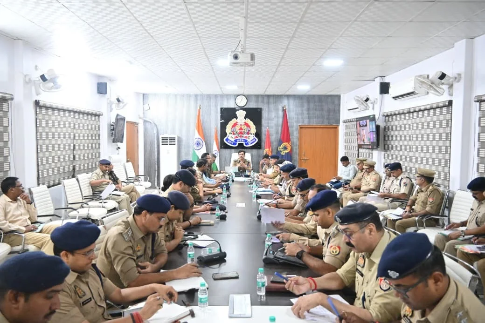
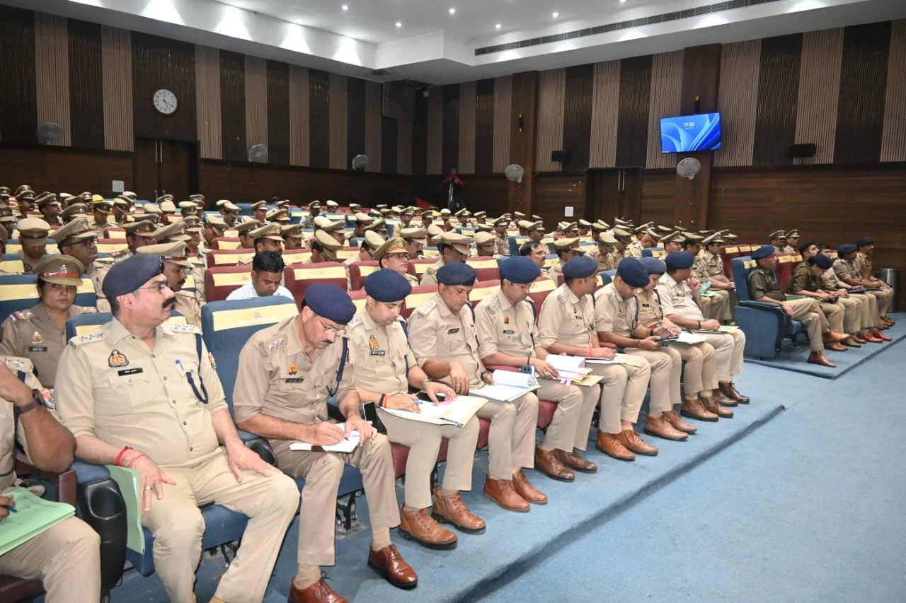

**वाराणसी।** मुख्यमंत्री योगी आदित्यनाथ और केंद्रीय रेल मंत्री के प्रस्तावित वाराणसी दौरे को लेकर कमिश्नरेट पुलिस ने सुरक्षा व्यवस्था की तैयारियां तेज कर दी हैं। 31 अक्टूबर को बनारस रेलवे स्टेशन से वंदे भारत ट्रेन को हरी झंडी दिखाए जाने के प्रस्तावित कार्यक्रम को सकुशल संपन्न कराने के लिए पुलिस आयुक्त मोहित अग्रवाल ने शुक्रवार को समस्त राजपत्रित पुलिस अधिकारियों के साथ ब्रीफिंग की। इस दौरान उन्होंने VIP सुरक्षा, यातायात व्यवस्था, भीड़ नियंत्रण और कार्यक्रम स्थल की सुरक्षा को लेकर आवश्यक दिशा-निर्देश दिए।

पुलिस आयुक्त ने अधिकारियों को निर्देश दिया कि सभी पुलिसकर्मी निर्धारित समय से पहले अपने ड्यूटी स्थल पर पहुंचें और मौके पर ही उनकी ब्रीफिंग कर जिम्मेदारियां स्पष्ट की जाएं। ड्यूटी के दौरान किसी भी प्रकार की लापरवाही बर्दाश्त नहीं की जाएगी। उन्होंने पुलिसकर्मियों को मोबाइल फोन का अनावश्यक इस्तेमाल न करने और आसपास की गतिविधियों पर पैनी नजर रखने की हिदायत दी।

VIP के आगमन, प्रस्थान और भ्रमण मार्गों पर सुरक्षा के पुख्ता इंतजाम करने के निर्देश दिए गए। प्रमुख चौराहों, गलियों, कट और संवेदनशील स्थानों पर पर्याप्त पुलिस बल तैनात रहेगा। वहीं, कार्यक्रम स्थल के सभी प्रवेश और निकास द्वारों पर सघन चेकिंग की जाएगी। बिना जांच किसी को भी प्रवेश नहीं दिया जाएगा। महिलाओं की चेकिंग महिला पुलिसकर्मियों द्वारा कराई जाएगी।

**ड्रोन और CCTV से होगी निगरानी**

सुरक्षा व्यवस्था को मजबूत बनाने के लिए कार्यक्रम स्थल, VIP रूट और आसपास के महत्वपूर्ण स्थानों की ड्रोन एवं CCTV कैमरों से लगातार निगरानी की जाएगी। संवेदनशील स्थानों पर रूफटॉप ड्यूटी लगाकर आसपास के क्षेत्रों पर नजर रखने के निर्देश भी दिए गए हैं। इसके साथ ही होटल, ढाबों, गेस्ट हाउस और अन्य ठहरने वाले स्थानों की सघन चेकिंग एवं संदिग्ध व्यक्तियों का सत्यापन कराया जाएगा।

**यातायात और भीड़ प्रबंधन पर विशेष जोर**

VIP मूवमेंट के दौरान यातायात व्यवस्था सुचारु बनाए रखने के लिए यातायात पुलिस को विशेष सतर्कता बरतने को कहा गया है। आवश्यकता के अनुसार डायवर्जन और वैकल्पिक मार्गों का इस्तेमाल किया जाएगा, ताकि आमजन को कम से कम परेशानी हो। वहीं, भीड़भाड़ वाले स्थानों पर रस्सों और बैरिकेडिंग के माध्यम से भीड़ को नियंत्रित करने के निर्देश दिए गए हैं। आपातकालीन आवागमन के लिए भी आवश्यक व्यवस्था सुनिश्चित की जाएगी।

पुलिस आयुक्त ने रेलवे प्रशासन, रेलवे सुरक्षा बल (RPF), राजकीय रेलवे पुलिस (GRP) और कमिश्नरेट पुलिस के बीच बेहतर समन्वय बनाए रखने पर जोर दिया। उन्होंने अधिकारियों को अपने-अपने क्षेत्रों में लगातार भ्रमण और ड्यूटी पर तैनात पुलिसकर्मियों की मॉनिटरिंग करने के निर्देश दिए। किसी भी संदिग्ध गतिविधि या आकस्मिक परिस्थिति की सूचना तत्काल साझा कर त्वरित कार्रवाई सुनिश्चित करने को कहा गया।

पुलिस आयुक्त ने स्पष्ट किया कि मुख्यमंत्री और केंद्रीय रेल मंत्री के प्रस्तावित दौरे के दौरान सुरक्षा व्यवस्था में किसी भी स्तर पर लापरवाही नहीं होनी चाहिए। 

**संवाददाता - पवन जायसवाल**
