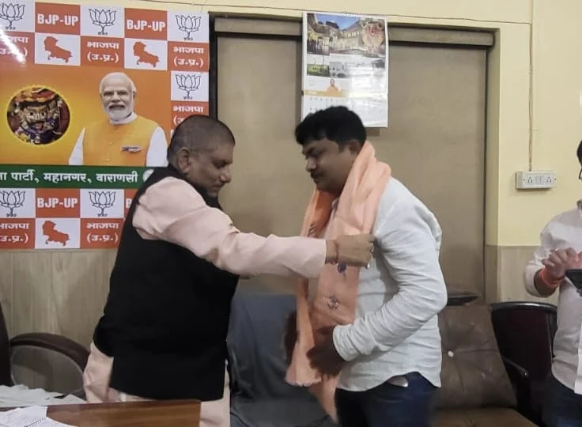

**वाराणसी।** भारतीय जनता पार्टी महानगर वाराणसी ने संगठनात्मक विस्तार की दिशा में बड़ा कदम उठाते हुए अनुसूचित जाति मोर्चा और अनुसूचित जनजाति मोर्चा की नई महानगर कार्यसमितियों की घोषणा की है। महानगर अध्यक्ष प्रदीप अग्रहरि ने दोनों मोर्चों के अध्यक्षों सहित विभिन्न पदों पर पदाधिकारियों की नियुक्ति की। नई कार्यसमितियों में रिंकू भारती को अनुसूचित जाति मोर्चा और मनोज गोंड को अनुसूचित जनजाति मोर्चा का महानगर अध्यक्ष बनाया गया है।

भाजपा महानगर अध्यक्ष प्रदीप अग्रहरि ने नवनियुक्त पदाधिकारियों को शुभकामनाएं देते हुए कहा कि भाजपा का उद्देश्य समाज के प्रत्येक वर्ग को साथ लेकर चलना और अंत्योदय की भावना के अनुरूप अंतिम व्यक्ति तक विकास का लाभ पहुंचाना है। उन्होंने विश्वास जताया कि नई कार्यसमितियों के गठन से संगठनात्मक गतिविधियों को गति मिलेगी और सामाजिक समरसता को और मजबूती मिलेगी।

**अनुसूचित जनजाति मोर्चा की नई टीम**

अनुसूचित जनजाति मोर्चा में मनोज गोंड को अध्यक्ष बनाया गया है। उपाध्यक्ष पद पर रमेश कुमार भारद्वाज, सतीश कुमार गोंड, सुनील कुमार गोंड, गोवर्धन खरवार, ओम प्रकाश खरवार, दीपक गोंड, प्रवीण खरवार और दीपू कश्यप को जिम्मेदारी दी गई है। महामंत्री पद पर धर्मेश बाबू गोंड, रितेश खरवार और अंकित गोंड नियुक्त किए गए हैं। वहीं मंत्री पद पर अर्जुन खरवार, अजीत कुमार गोंड, विजय गोंड, दीपचन्द्र गोंड, प्रदीप गोंड और आशीष सिंह गोंड को शामिल किया गया है।

**अनुसूचित जाति मोर्चा की कार्यसमिति घोषित**

अनुसूचित जाति मोर्चा की कमान रिंकू भारती को सौंपी गई है। उपाध्यक्ष पद पर अभिषेक सोनकर, राजीव बेन्वंशी, मनोज कुमार, सुनील सोनकर, सुरेश प्रसाद, आवेश कुमार, सुनील सोनकर और आशीष कुमार को नियुक्त किया गया है। महामंत्री पद पर दीपू कनौजिया, मुरारी गौतम और साहिल सोनकर को जिम्मेदारी मिली है। मंत्री पद पर बादल सोनकर, सचिन बाल्मीकि, मिथलेश पासवान, आलोक कुमार, निष्या भारती, नवीन बाल्मीकि, किशन सोनकर और जय धारिया को शामिल किया गया है।

इसके अलावा संतोष सोनकर को कोषाध्यक्ष, कुंवर कर्मवीर और आनंद कुमार को सह-कोषाध्यक्ष बनाया गया है। मीडिया संयोजक की जिम्मेदारी संतोष कुमार को दी गई है। आकाश कुमार और ध्रुव कुमार मीडिया सह-संयोजक होंगे। अजय सोनकर को कार्यालय मंत्री, जबकि दीपू चौधरी और निहाल सोनकर को सह कार्यालय मंत्री नियुक्त किया गया है। सोशल मीडिया संयोजक अवधेश कुमार बनाए गए हैं। रवि शंकर कुमार और अजय कुमार को सोशल मीडिया सह-संयोजक की जिम्मेदारी सौंपी गई है।

नई कार्यसमितियों में शामिल पदाधिकारियों ने पार्टी नेतृत्व के प्रति आभार जताते हुए संगठन को मजबूत बनाने, सामाजिक समरसता बढ़ाने और समाज के सर्वांगीण विकास के लिए पूरी निष्ठा से कार्य करने का संकल्प लिया।

नवनियुक्त पदाधिकारियों को चंद्रशेखर उपाध्याय, नवीन कपूर, प्रमील पाण्डेय, कुशाग्र श्रीवास्तव, प्रमोद यादव मुन्ना, वैभव उपाध्याय, राकेश जायसवाल, अनिल उपाध्याय, मधुप सिंह, अमित खरे, अजय गुप्ता, पंकज चतुर्वेदी, विनय सिंह और अभिषेक श्रीवास्तव सहित महानगर के कई पार्टी पदाधिकारियों एवं कार्यकर्ताओं ने बधाई दी।

**संवाददाता - पवन जायसवाल**
