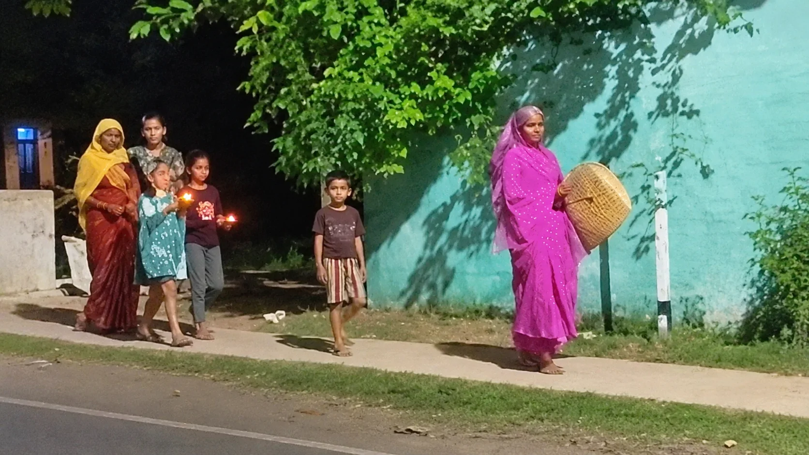

**चंदौली।** दीपावली का पर्व केवल दीप जलाने और मां लक्ष्मी की पूजा तक सीमित नहीं है, बल्कि यह हमारी लोकसंस्कृति, परंपराओं और पीढ़ियों से चली आ रही मान्यताओं का भी प्रतीक है। चंदौली जनपद में दिवाली की भोर में एक अनूठी लोकपरंपरा निभाई जाती है। इस परंपरा के तहत महिलाएं पुराने सूप और हंसिए को बजाकर घर से दरिद्रता और नकारात्मकता को विदा करने की कामना करती हैं। वहीं सरसों के तेल से जलाए गए दीपक की लौ से विशेष काजल तैयार करने की परंपरा भी प्रचलित है।

**सूप और हंसिए की आवाज से दरिद्रता को विदाई**

दीपावली की सुबह होने से पहले ही घरों में महिलाएं उठकर आंगन और मुख्य दरवाजे पर पहुंचती हैं। इसके बाद पुराने सूप और हंसिए को बजाते हुए लोकवाक्य "ईश्वर पैठें, दरिद्दर भागै" का उच्चारण करती हैं। लोकमान्यता है कि ऐसा करने से घर में व्याप्त दरिद्रता, दुर्भाग्य और नकारात्मकता दूर होती है तथा सुख-समृद्धि और खुशहाली का आगमन होता है।

इस परंपरा में सूप को अन्न, अन्नपूर्णा और गृहस्थ जीवन का प्रतीक माना जाता है, जबकि हंसिया कृषि और मेहनत का प्रतीक है। इनके माध्यम से परिवार में अन्न की कमी न होने, मेहनत का फल मिलने और घर में खुशहाली बने रहने की मंगलकामना की जाती है।

**सरसों के तेल के दीपक से होता है उजाले का स्वागत**

दीपावली की अमावस्या की रात सरसों के तेल का दीपक जलाने की भी विशेष परंपरा है। मान्यता है कि दीपक का प्रकाश घर के कोने-कोने तक पहुंचे और जीवन से अंधकार दूर हो। दीपक जलाना केवल धार्मिक आस्था नहीं, बल्कि अंधकार पर प्रकाश और निराशा पर आशा की जीत का प्रतीक भी है।

**दीपक की लौ से तैयार किया जाता है अमावस्या का काजल**

इस लोकपरंपरा का एक खास पहलू अमावस्या का काजल भी है। परंपरागत रूप से दीपक की लौ से निकलने वाली कालिख को एकत्र कर काजल तैयार किया जाता है। इसके बाद परिवार के सदस्यों को इसे लगाया जाता है। घर के बड़े-बुजुर्गों से लेकर बच्चों तक को काजल लगाने की परंपरा निभाई जाती है।

लोकविश्वास के अनुसार अमावस्या की रात तैयार किया गया यह काजल बुरी नजर से बचाने और आंखों की रक्षा करने का प्रतीक माना जाता है। हालांकि यह एक पारंपरिक मान्यता है। आधुनिक चिकित्सा के अनुसार दीपक की कालिख या घरेलू काजल को आंखों में लगाना सुरक्षित नहीं माना जाता।

**लोकपरंपराओं में छिपा है परिवार की खुशहाली का संदेश**

दरअसल, दिवाली की भोर में निभाई जाने वाली ये परंपराएं केवल धार्मिक अनुष्ठान नहीं, बल्कि लोकजीवन, पारिवारिक एकजुटता और सांस्कृतिक विरासत की पहचान हैं। सूप और हंसिए की आवाज के साथ दरिद्रता को विदा करने की कल्पना और दीपक के प्रकाश से सुख-समृद्धि का स्वागत करने की भावना इस परंपरा को खास बनाती है।

आधुनिकता के दौर में भले ही जीवनशैली बदल रही हो, लेकिन ऐसी लोकपरंपराएं आज भी हमारी सांस्कृतिक जड़ों को जीवंत बनाए हुए हैं। इन रीति-रिवाजों में परिवार के मंगल की कामना, बुजुर्गों का अनुभव और आने वाले समय को खुशहाल बनाने की उम्मीद समाहित है।

दिवाली की यह अनूठी परंपरा संदेश देती है कि जीवन से अंधकार और नकारात्मकता को दूर कर प्रेम, शांति, उजाले और समृद्धि का स्वागत किया जाए। यही हमारी लोकसंस्कृति की असली पहचान है।
