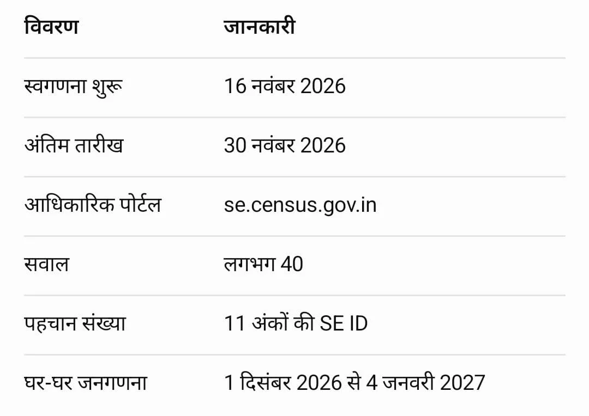

**लखनऊ।** उत्तर प्रदेश में जनगणना 2027 के दूसरे चरण को लेकर तैयारियां तेज हो गई हैं। इस बार नागरिकों को जनगणना में शामिल होने के लिए एक बड़ी सुविधा दी जा रही है। अब लोग घर बैठे अपने मोबाइल या कंप्यूटर के माध्यम से परिवार का पूरा ब्योरा खुद दर्ज कर सकेंगे।

स्वगणना यानी सेल्फ एन्यूमरेशन की प्रक्रिया 16 नवंबर से शुरू होकर 30 नवंबर 2026 तक चलेगी।

इसके लिए नागरिकों को भारत सरकार के आधिकारिक पोर्टल **https://se.census.gov.in**⁠ पर जाना होगा। यहां उत्तर प्रदेश का चयन करने के बाद मोबाइल नंबर और ओटीपी के जरिए सत्यापन करना होगा।

इसके बाद परिवार के सभी सदस्यों की जानकारी भरनी होगी। पोर्टल पर पूछे गए करीब 40 सवालों के जवाब देने होंगे। साथ ही डिजिटल मानचित्र पर अपने घर की सही लोकेशन भी चिह्नित करनी होगी।

पूरी जानकारी भरने और सबमिट करने के बाद नागरिकों को 11 अंकों की विशेष पहचान संख्या यानी एसई आईडी मिलेगी।

यह आईडी बेहद महत्वपूर्ण होगी। जब जनगणना कर्मचारी घर पहुंचेंगे, तब परिवार को यह एसई आईडी दिखानी होगी, जिसके आधार पर ऑनलाइन दर्ज जानकारी का सत्यापन किया जाएगा।

नागरिकों को सलाह दी गई है कि अंतिम सबमिशन से पहले परिवार के सभी सदस्यों और अन्य जानकारियों को अच्छी तरह जांच लें, ताकि किसी तरह की गलती न हो।

गौरतलब है कि उत्तर प्रदेश में जनगणना के दूसरे चरण के तहत घर-घर जाकर जनसंख्या गणना का कार्य 1 दिसंबर 2026 से 4 जनवरी 2027 तक निर्धारित है।

इस बार डिजिटल माध्यम से जनगणना की व्यवस्था नागरिकों के लिए प्रक्रिया को अधिक सुविधाजनक बनाने की दिशा में महत्वपूर्ण कदम मानी जा रही है I

रिपोर्ट- ऋषिदेव उपाध्याय
