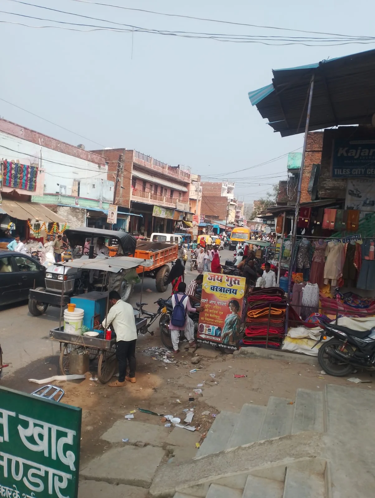

**चंदौली।** सैदूपुर बाजार में जाम की समस्या दिन-ब-दिन गंभीर होती जा रही है। बाजार में दुकानों और प्रतिष्ठानों का विस्तार तो लगातार हो रहा है, लेकिन पार्किंग की समुचित व्यवस्था नहीं होने से आम लोगों को भारी परेशानी का सामना करना पड़ रहा है। स्थिति यह है कि बाजार के महज 500 मीटर के दायरे में ही आए दिन भीषण जाम लग जाता है।

खरीदारी के लिए आने वाले ग्राहक अपने दोपहिया और चारपहिया वाहनों को दुकानों के सामने सड़क पर ही खड़ा कर देते हैं। इससे सड़क की चौड़ाई कम हो जाती है और आवागमन बाधित होने लगता है। ऐसे में जब ट्रक, बस जैसे बड़े वाहन बाजार में प्रवेश करते हैं तो जाम की स्थिति और विकराल हो जाती है।

जाम के कारण स्थानीय व्यापारियों, राहगीरों और आसपास के गांवों से आने-जाने वाले लोगों को काफी दिक्कतों का सामना करना पड़ता है। कई बार लोगों को थोड़ी सी दूरी तय करने में भी काफी समय लग जाता है।

विडंबना यह है कि बाजार का दायरा लगातार बढ़ रहा है, लेकिन यातायात व्यवस्था और पार्किंग की समस्या के समाधान के लिए अब तक कोई ठोस पहल नजर नहीं आ रही है।

स्थानीय लोगों ने प्रशासन से बाजार में व्यवस्थित पार्किंग की व्यवस्था कराने, सड़क पर बेतरतीब वाहन खड़ा करने पर रोक लगाने और अतिक्रमण नियंत्रित करने की मांग की है। लोगों का कहना है कि समय रहते प्रभावी कदम नहीं उठाए गए तो आने वाले दिनों में जाम की समस्या और गंभीर हो सकतीहै।

**रिपोर्ट- अनिल द्विवेदी**
