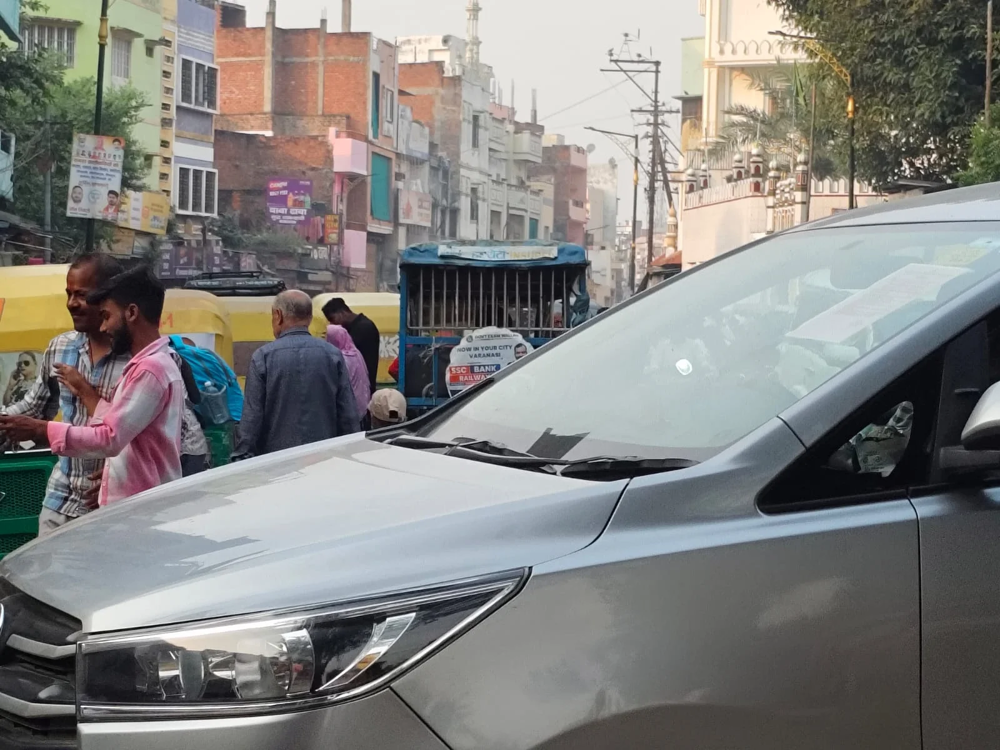

**वाराणसी।** धर्म और आध्यात्म की नगरी काशी में जाम की समस्या लोगों के लिए लगातार मुसीबत बनती जा रही है। शहर के प्रमुख चौराहों और सड़कों पर रोजाना लगने वाले जाम से आम जनता को भारी परेशानियों का सामना करना पड़ रहा है। लेकिन सबसे बड़ा सवाल यह है कि आखिर पुलिस कमिश्नर के सख्त आदेशों के बावजूद जाम की समस्या पर लगाम क्यों नहीं लग पा रही है?

दरअसल, 4 जुलाई 2024 को वाराणसी के पुलिस कमिश्नर मोहित अग्रवाल ने सभी थाना प्रभारियों और चौकी इंचार्जों को सख्त निर्देश जारी किए थे। आदेश में स्पष्ट कहा गया था कि थाना क्षेत्र में जाम की स्थिति बनने पर संबंधित थाना प्रभारी और चौकी इंचार्ज की जवाबदेही तय होगी और लापरवाही मिलने पर कार्रवाई की जाएगी। शुरुआत में इस आदेश का असर भी दिखाई दिया, लेकिन समय बीतने के साथ हालात फिर पुराने ढर्रे पर लौटते नजर आ रहे हैं।

इसकी एक तस्वीर शहर के व्यस्ततम बेनियाबाग तिराहे पर देखने को मिल रही है। यहां कथित अवैध ऑटो स्टैंड और सड़क किनारे खड़े ऑटो के चलते आए दिन लंबा जाम लग रहा है। राहगीरों, स्थानीय दुकानदारों और वाहन चालकों को घंटों परेशानी झेलनी पड़ती है।

हैरानी की बात यह है कि बेनियाबाग तिराहे से महज कुछ कदम की दूरी पर पानदरीबा पुलिस चौकी स्थित है। इसके बावजूद यहां ऑटो स्टैंड के कारण यातायात बाधित होने की शिकायतें सामने आ रही हैं। ऐसे में सवाल उठना लाजिमी है कि आखिर इस समस्या पर प्रभावी कार्रवाई क्यों नहीं हो रही है?

गौरतलब है कि वाराणसी पुलिस ने शहर के 20 प्रमुख स्थानों को जाम के ब्लैक स्पॉट के रूप में चिह्नित किया था। इनमें ककरमत्ता पुल, भिखारीपुर तिराहा, सुंदरपुर चौराहा, मालवीय चौराहा बीएचयू गेट, नगवा चौराहा, सामने घाट पुल, टेंगरा मोड़, रामनगर चौराहा, सूजाबाद-पड़ाव चौराहा, राजघाट से नमो घाट तक का मार्ग, आदमपुर रेलवे क्रॉसिंग, भदऊ चुंगी रेलवे डाट पुल, गोदौलिया, रामापुरा, बेनियाबाग, गुरुबाग, रथयात्रा, मैदागिन, नीमा माई तिराहा और कचहरी चौराहा शामिल हैं।

इसके बावजूद इन स्थानों पर जाम की समस्या लगातार बनी हुई है। सवाल यह भी है कि जिन स्थानों को जाम मुक्त बनाने के लिए ब्लैक स्पॉट घोषित किया गया था, वहां आज भी हालात क्यों नहीं सुधर रहे?

अब जरूरत है कि पुलिस कमिश्नर मोहित अग्रवाल अपने पुराने आदेशों की दोबारा समीक्षा करें और सभी थाना प्रभारियों व चौकी इंचार्जों की जवाबदेही सुनिश्चित करें। बेनियाबाग तिराहे पर कथित अवैध ऑटो स्टैंड के खिलाफ निष्पक्ष जांच कराकर आवश्यक कार्रवाई की जाए, ताकि आम जनता को रोजाना लगने वाले जाम से राहत मिल सके।

अब देखना होगा कि पुलिस प्रशासन इस समस्या पर कब तक कार्रवाई करता है, या फिर जाम से जूझती काशी की जनता यूं ही परेशान होती रहेगी?

**रिपोर्ट- विशु उपाध्याय**
