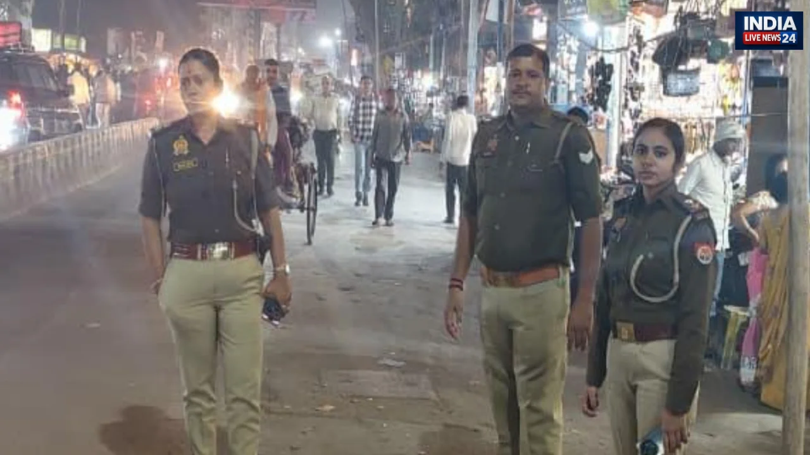

**वाराणसी।** चेतगंज थाना क्षेत्र अंतर्गत पानदरीबा चौकी के बेनियाबाग इलाके को जाम मुक्त कराने का अभियान लगातार जारी है। एसीपी चेतगंज शुभम जैन के नेतृत्व में पुलिस यातायात व्यवस्था को सुचारु बनाने के लिए पूरी तरह सक्रिय नजर आ रही है।

वहीं, पानदरीबा चौकी प्रभारी शिप्रा सिंह (लेडी सिंघम) एक्शन मोड में दिखाई दे रही हैं। छठ पूजा को देखते हुए उन्होंने सुरक्षा व्यवस्था के साथ-साथ यातायात प्रबंधन पर भी विशेष फोकस किया है। बेनियाबाग क्षेत्र में लगने वाले जाम से आम नागरिकों, राहगीरों और श्रद्धालुओं को राहत दिलाने के लिए पुलिस टीम लगातार सक्रिय है।

चौकी प्रभारी शिप्रा सिंह स्वयं सड़क पर उतरकर यातायात व्यवस्था को व्यवस्थित कराने में जुटी हैं, ताकि पर्व के दौरान श्रद्धालुओं को आवागमन में किसी प्रकार की परेशानी न हो। पुलिस की प्राथमिकता है कि छठ पूजा शांतिपूर्ण ढंग से संपन्न हो और क्षेत्र में यातायात व्यवस्था बाधित न होने पाए।

एसीपी चेतगंज शुभम जैन के नेतृत्व में चल रही इस पहल और चौकी प्रभारी शिप्रा सिंह की सक्रियता से बेनियाबाग को जाम मुक्त बनाने की दिशा में लगातार प्रयास किए जा रहे हैं।

**रिपोर्ट - ए जावेद**
