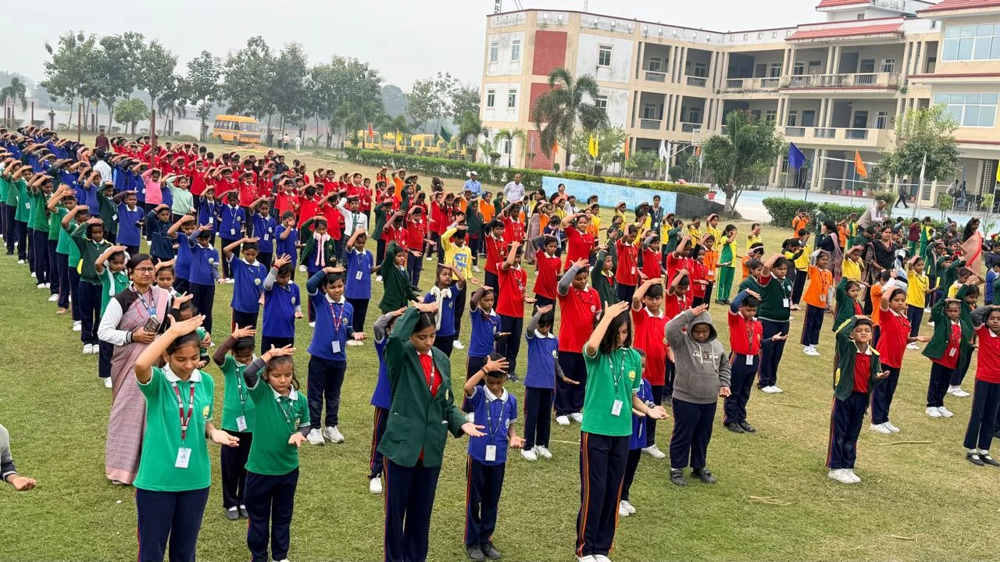

**चन्दौली।** जनपद के चकिया तहसील क्षेत्र के मवैया स्थित राइजिंग सन वर्ल्ड स्कूल में विद्यार्थियों के शारीरिक, मानसिक एवं आत्मिक विकास के उद्देश्य से सहज योग कार्यक्रम का आयोजन किया गया। कार्यक्रम में विद्यार्थियों को सहज योग, ध्यान, योग साधना और कुंडलिनी जागरण के महत्व की जानकारी देते हुए इसे दैनिक जीवन में अपनाने के लिए प्रेरित किया गया।

कार्यक्रम के दौरान वक्ताओं ने बताया कि नियमित ध्यान और योग साधना से मन को शांत रखने, एकाग्रता बढ़ाने, आत्मविश्वास विकसित करने और सकारात्मक सोच को मजबूत बनाने में मदद मिलती है। विद्यार्थियों को कुंडलिनी जागरण की प्रक्रिया तथा शरीर में स्थित विभिन्न चक्रों की स्थिति, विशेषताओं और उनके महत्व के बारे में भी सरल शब्दों में समझाया गया।

वक्ताओं ने कहा कि पढ़ाई के साथ-साथ मानसिक शांति और आत्मिक संतुलन भी बेहद जरूरी है। स्वस्थ शरीर, शांत मन और सकारात्मक विचार ही बेहतर व्यक्तित्व एवं सफल जीवन का आधार हैं।

कार्यक्रम का शुभारंभ विद्यालय के एमडी डायरेक्टर परवीन रुस्तम, प्रधानाचार्या विभा सिंह, उपप्रधानाचार्य मुकेश कुमार सिंह सहित सहज योग से पधारे अतिथियों ने मां सरस्वती की प्रतिमा पर माल्यार्पण एवं दीप प्रज्वलित कर किया।

इस अवसर पर सुधीर कुमार सिंह, सुमन द्विवेदी, विजय, गीता द्विवेदी, सिम्मी श्रीवास्तव, प्रमोद श्रीवास्तव, मीरा सिंह एवं डॉ. विजय लक्ष्मी सिंह सहित विद्यालय के शिक्षक और विद्यार्थी उपस्थित रहे।

कार्यक्रम ज्ञानवर्धक एवं प्रेरणादायक रहा। अंत में विद्यालय परिवार की ओर से सभी अतिथियों के प्रति आभार व्यक्त किया गया।

**रिपोर्ट- अनिल द्विवेदी**
