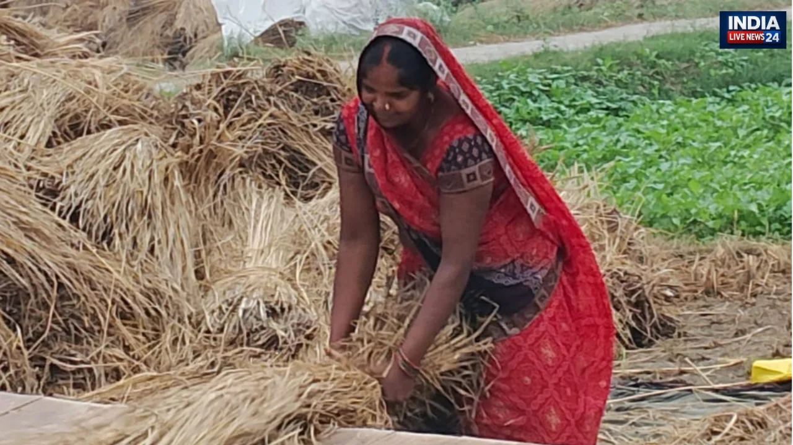

**चंदौली।** जनपद चंदौली और आसपास के क्षेत्रों में हुई बेमौसम बारिश ने किसानों की मुश्किलें बढ़ा दी हैं। अचानक बदले मौसम से जहां धान और सब्जियों की फसल को नुकसान पहुंचने की आशंका है, वहीं चना और मटर जैसी दलहनी फसलों के लिए यह बारिश राहत लेकर आई है। बारिश का असर खेती-किसानी पर मिला-जुला देखने को मिल रहा है।

बारिश के कारण खेतों में कटाई के बाद रखे गए धान के बोझे भीग गए हैं। इससे धान में नमी बढ़ने, दानों का रंग बदलने और फसल की गुणवत्ता प्रभावित होने की आशंका है। वहीं जिन किसानों की धान की फसल अभी खेतों में खड़ी है, उन्हें भी नुकसान की चिंता सता रही है।

सब्जी उत्पादक किसानों की परेशानी भी बढ़ गई है। खासकर टमाटर की फसल पर बारिश का प्रतिकूल असर पड़ने की आशंका जताई जा रही है। खेतों में जलभराव और लगातार नमी रहने से पौधों की जड़ों और फलों की गुणवत्ता प्रभावित हो सकती है, जिससे किसानों को आर्थिक नुकसान उठाना पड़ सकता है।

हालांकि, दूसरी ओर चना और मटर की बुवाई कर चुके किसानों के लिए हल्की बारिश फायदेमंद साबित हो सकती है। मिट्टी में नमी बढ़ने से फसलों के अंकुरण में मदद मिलने की उम्मीद है। गेहूं की बुवाई करने वाले किसानों के लिए भी बारिश का असर खेतों में जलनिकासी और नमी की स्थिति पर निर्भर करेगा।

किसान ओमप्रकाश राय का कहना है कि खेती पूरी तरह मौसम पर निर्भर है। धान की फसल तैयार करने में महीनों की मेहनत और पूंजी लगती है, लेकिन कटाई के समय हुई बारिश किसानों की मेहनत पर पानी फेर सकती है। इससे किसानों के सामने आर्थिक संकट खड़ा होने की आशंका है।

किसानों ने प्रशासन और संबंधित कृषि विभाग से प्रभावित क्षेत्रों का स्थलीय निरीक्षण कराकर फसलों के नुकसान का निष्पक्ष आकलन कराने की मांग की है। साथ ही प्रभावित किसानों को नियमानुसार उचित मुआवजा और राहत उपलब्ध कराने की अपील की है।

फिलहाल बेमौसम बारिश ने चंदौली के किसानों की चिंता बढ़ा दी है। अब किसानों की निगाहें मौसम के अगले रुख और प्रशासन की कार्रवाई पर टिकी हैं।

**रिपोर्ट - अनिल द्विवेदी**
